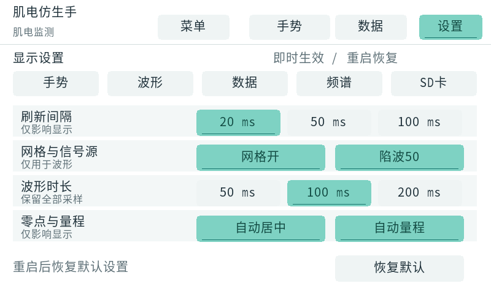
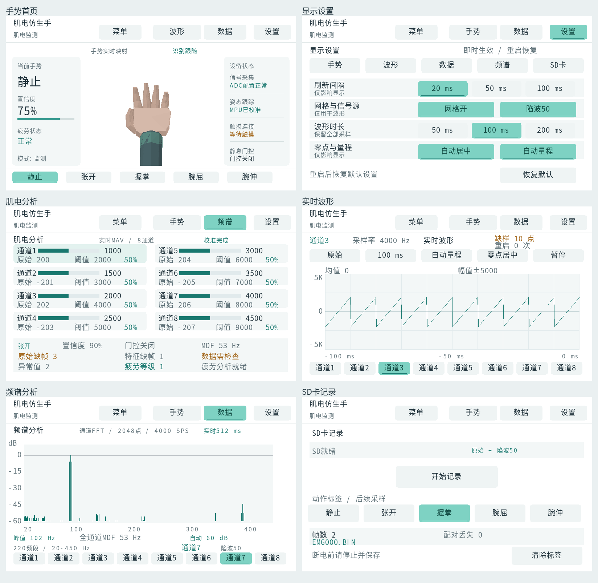
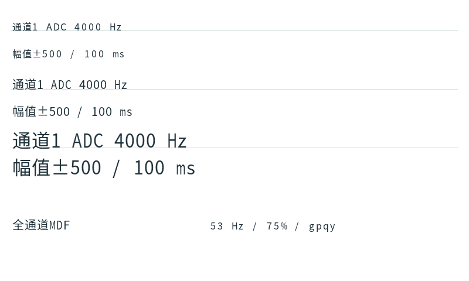

# 中英文、数字与单位基线修正

固件标识：`20261021_LCD_TEXT_BASELINE`。

问题根因有两层：中文逐字按墨迹包围盒居中，ASCII 又使用较小字号与独立
基线；页面中部分同排字段混用字号和纵坐标，图表刻度还沿用旧字模的
7/14 像素高度常量。

修正如下：

- 同一字号的中文、数字、字母、单位与符号都按思源黑体的共同基线生成，
  保留字体原有纵向偏移，去除逐字居中与 ASCII 独立缩小。
- 字模行框保留下伸笔画，不裁切 `g/p/q/y`；字模头文件导出字号、
  行框高度、基线和存储偏移，固件绘制与控件居中共同使用这些信息。
- 肌电分析与频谱标题、数据汇总、频谱详情中的不同字号字段按同行
  基线定位；设置标题与数据行数值也使用一致的纵坐标。
- 波形时间刻度统一字号和纵坐标，按真实测宽居中；波形/频谱纵轴
  刻度按当前行框高度定位。
- 保留现有白底布局、触摸区域、自然肤色与信号处理逻辑。

字体测试 `python sim/test_lcd_font.py` 对照原始字体，在四种字号下检查
中文纵向偏移、大写字母与数字底部、小写下伸笔画和字形裁切。
LCD 主机回归还检查实际固件字模，导出 `typography_800.ppm` 与
`typography_1024.ppm` 供观察三档字号及不同字号同行排版。

验证日志：`lcd_baseline_font_test_20261021.log`、
`lcd_baseline_test_20261021.log`、`lcd_baseline_arm_20261021.log`、
`lcd_baseline_gates_20261021.log`。产物校验见
`lcd_baseline_artifacts_20261021.json`。

预览由真实固件绘图与模拟输入产生；尚未上板检查。

结果：字体测试、800×480 与 1024×600 的 LCD 回归、ARM 编译全部通过。
打包复用现有 PL 位流，G1–G5 检查全部通过；未重新综合或布线，
也未向开发板烧录。ARM 编译只有供应商 FatFs 的既有未使用变量告警。
已检查两种尺寸的首页、设置、数据、波形、频谱和 SD 页，以及基线示例。

