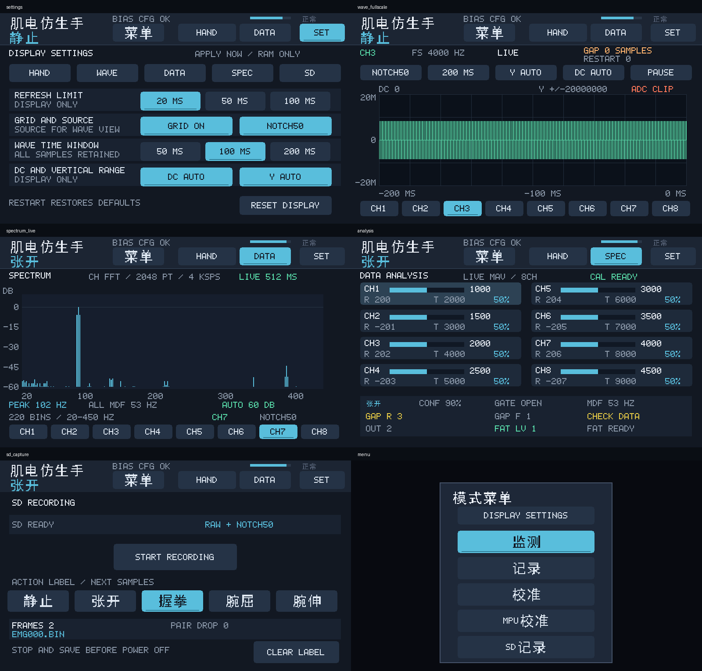

# LCD 界面与设置优化

固件标识：`20261018_LCD_UI_V2`。本次修改 PS 裸机界面，复用原有三帧缓冲、分片绘图、触摸分发、波形采样环和 SD 录制接口。

## 操作

页头新增 **SET**；菜单中也可点击 **DISPLAY SETTINGS**。设置页首行直接打开 HAND、WAVE、DATA、SPEC、SD。页头 DATA/SPEC 在分析和频谱页之间切换，HAND 返回手部视图；手部视图中的 WAVE 打开波形。

| 设置 | 选项及作用 |
| --- | --- |
| REFRESH LIMIT | 20 / 50 / 100 ms，限制常规绘图的最小构建间隔；触摸变更优先响应，不代表实际帧率 |
| GRID | 同时控制波形、频谱网格；坐标文字和频谱基线保留 |
| SOURCE | RAW / NOTCH50，仅选择波形显示源；切换时清空显示历史并恢复运行 |
| WAVE TIME WINDOW | 50 / 100 / 200 ms，保留选定通道每个样本 |
| DC | AUTO 按当前显示窗口均值居中，ZERO 以零为中心 |
| Y AUTO | 恢复波形自动量程；固定量程仍可在波形页循环选择 |
| RESET DISPLAY | 恢复 20 ms、网格开启、NOTCH50、100 ms、DC AUTO、Y AUTO，保留波形通道 |

设置仅存在 RAM，重启恢复默认值。网格、偏移和量程只影响绘图；刷新设置不改变 ADC 采样率。波形源选择不改变识别、频谱或 SD 的数据源。页面切换不停止 SD 录制，停止保存仍须在 SD 页操作。

## 显示调整

- 统一深色面板、青色选中按钮、文字居中和选中标记。
- 按实际像素测宽：ASCII 至少 2×，中文按 16×16 字模计算；过长文字在区域内以省略号截断，不截断 UTF-8 汉字。
- 补充点、冒号、斜杠、加号、百分号、等号和比较符号字模；中英文混排垂直居中。
- 顶栏分开动作、门控、ADC 配置状态、置信度条、疲劳状态和导航。
- 波形纵轴用 K/M 简写，顶部保留准确的 ADC count 范围；VIEW CLIP 与 ADC CLIP 优先显示一个。
- 频谱纵轴改为紧凑 dB 刻度，分开 FFT 信息、状态、峰值、全通道 MDF、选中通道和来源。
- DATA 卡片分开活动条、MAV、原始值、阈值和比例；底部诊断分成三行。
- SD 页分开录制状态、开始/停止、中文动作标签、帧数、文件名、配对缺失和错误码。

## 验证与限制

回归调用实际 `main.c` 绘图和触摸代码，覆盖 800×480、1024×600。导出的 PPM 为真实固件渲染结果，信号由主机测试合成。复现：

```powershell
powershell -ExecutionPolicy Bypass -File build/scripts/run_lcd_firmware_test.ps1
powershell -ExecutionPolicy Bypass -File build/scripts/run_uart_record_test.ps1
cmd /c sw\ps_uart_print\build.bat
powershell -ExecutionPolicy Bypass -File build/build_all.ps1 -SkipBuild
```

LCD 回归包含设置触摸与复位、五个页面路由、中英文文字截断、SD 活动状态保持、完整/局部绘图像素一致、缓冲区归属、越界保护及原有波形/FFT/IMU 测试。SD 连续性测试使用模拟存储接口，仅证明界面操作不停止录制，不能代替实卡长时间写入测试。

结果：两种分辨率 LCD 回归通过、UART 采集回归通过、ARM 编译通过，G1–G5 打包门禁全部通过。最终 ELF 内含上述固件标识，BOOT.BIN 为 4,311,604 字节。编译仅有供应商 FatFs `ff.c` 的既有未使用变量 `vol` 告警。本次已逐页检查两种分辨率的导出渲染图；大幅波形是测试输入，非本次人体采集。

结果：两种分辨率 LCD 回归通过、UART 采集回归通过、ARM 编译通过，G1–G5 打包门禁全部通过。最终 ELF 内含上述固件标识，BOOT.BIN 为 4,311,604 字节。编译仅有供应商 FatFs `ff.c` 的既有未使用变量 `vol` 告警。本次已逐页检查两种分辨率的导出渲染图；大幅波形是测试输入，非本次人体采集。

本次复用已布线的 PL 位流，未重新综合。最终构建结果和产物校验见同目录 `lcd_ui_arm_build_20261018.log`、`lcd_ui_gates_20261018.log` 和 `lcd_ui_artifacts_20261018.json`。尚未向目标板烧录，触摸手感、实屏效果、实际帧率与长时间 SD 录制仍需上板确认。


