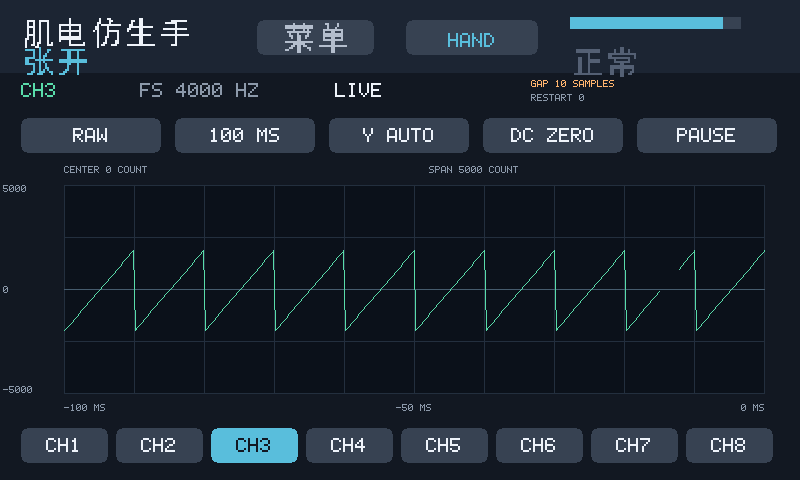

# 2026-10-15 LCD 单通道逐点实时波形

已在 PS 裸机固件加入可切换的单通道波形页，版本 `20261015_LCD_WAVE_V1`。
默认 CH1、PL 50 Hz 陷波源、100 ms 时窗、自动纵轴、窗口均值居中。
使用 DMA 中已有的 type 1 / type 5 数据，不增加 PL 接口，不修改 ADS1299
配置、识别输入、门控或串口帧协议。

## 操作

1. 页头点击 **WAVE** 进入波形页，点击 **HAND** 返回虚拟手。模式菜单仍可用。
2. 底部 **CH1–CH8** 选择物理通道；**NOTCH50 / RAW** 选择显示源，切源/切通道
   清空历史并恢复实时显示。这个选择与 PC 录制源独立。
3. 时窗按钮循环 **50 / 100 / 200 MS**；分别显示最近 200 / 400 / 800 个采样
   时刻，有缺失时显示点数相应减少。采样率每通道 4000 Hz，曲线连接有符号样本，
   不做整流、绝对值、RMS、MAV 或包络。
4. **Y AUTO** 自动选择纵轴范围，点击循环固定半量程：100 / 500 / 2000 /
   10000 / 50000 / 200000 / 1000000 / 10000000 count，再回 AUTO。
   正负轴刻度相对于 CENTER，SPAN 是半量程；固定量程超出时显示 **CLIP**。
5. **DC AUTO** 只为绘图减去可见窗口的样本均值，CENTER 显示该均值；
   **DC ZERO** 使用原始零值为中心。单位均为 ADC count，没有假定 ADC 增益换算 µV。
6. **PAUSE / RUN** 冻结/恢复最近数据。暂停时采集/识别/PC 录制继续，
   仍可调整冻结快照的时窗、纵轴和中心；快照最多保留 200 ms。

监测串口 115200 额外支持 `w` 切换页面、`1`–`8` 选择通道，便于触摸异常时使用。
这些命令仅在监测模式解释，不向二进制录制流添加文本。

## 数据完整性与调度

仅缓存所选源/通道的 1024 个有符号 int24 样本及序号；截图时复制最近 200 ms，
随后把每对相邻样本写入不可变绘图命令。绘图期间继续收样不改写当前命令表。
横坐标由 uint16 采样序号的间距生成，正常回绕 65535→0 连续。
缺样保留时间空隙且断线，重复序号忽略，逆序/重启清空当前历史。
GAP 统计自切换通道/源后检测到的缺失样本数，RESTART 统计逆序重启次数，
不代表整个系统的所有丢包。

选择的源尚无数据时显示 WAIT DATA；停止收样约 250 ms 后显示 NO DATA。
波形不等待静息校准，也不被 rest 门控清零。复用现有三帧缓冲、帧边界切换、
cache clean 和每次约 2 ms 的分段绘制预算。相邻点最多 799 条折线，
适配现有 1536 条绘图指令上限。软件按 20 ms 间隔调度新画面；
50 FPS 是调度上限，未测量实机帧率、采样到屏幕延迟或持续录制丢样率。

## 已执行验证

| 检查 | 结果与范围 |
| --- | --- |
| `run_lcd_firmware_test.ps1` | PASS，直接编译真实 main.c；原有 IMU/腕屈伸、菜单、三缓冲所有权、清缓存顺序、计时器回绕回归保持通过 |
| 波形数据回归 | PASS，正负 int24 极值、源/通道隔离、非法头、重复、序号正向回绕/逆序、环形缓冲回绕、缺口时间位置 |
| 波形绘图回归 | PASS，800×480 / 1024×600；触摸切换八通道/源/时窗/DC/量程/暂停/返回；暂停仍采集；满量程交替；绘制中收新样；缺口断线；NO DATA/计时回绕 |
| 像素及边界检查 | PASS，增量绘制与独立完整绘制的逐字节像素相同；帧缓冲边界哨兵未改变；未出现绘图列表溢出；已目视检查 800×480 正负曲线和暂停量程截图 |
| `run_uart_record_test.ps1` | PASS，两录制源、负数、序号、混帧、切源、非法头和原始诊断；新增 LCD 观察另一源/CH8 时二进制录制帧仍逐字节一致 |
| ARM `build.bat` | BUILD OK，无编译告警；新固件成功链接在现有 2 MiB APP 内存区 |
| `build_all.ps1 -SkipBuild` | ALL GATES PASS；复用已有 PL 综合/布线结果，重新检查 G1 参数、G2 系数、G3 DSP、G4 原时序及 G5 本次 BOOT 位流分区一致性 |
| 新 PS 镜像检查 | ELF 两个含文件数据的 PT_LOAD 段在 BOOT.BIN 中逐字节匹配；新 BUILD_TAG 同时存在于 ELF 与 BOOT |

没有重新综合或布线。复用的 PL 位流 SHA-256 仍为
`f145dfa7df40460097290d9adb8b9bc092614bcf7248bc26515968e806ff67a2`，
其已有布线 WNS＝+0.570 ns、WHS＝+0.031 ns。旧约束/复位告警见
[陷波验证记录](notch50_validation_20261015.md)；本轮不增加新的硬件实测结论。

## 交付

| 文件 | 字节数 | SHA-256 |
| --- | ---: | --- |
| `build/boot/BOOT.BIN` | 4263004 | `678e9cdbef0a5d21f60347697ff12ef2e4a28e38a0c5a7ff6fe0604e4aa1fb3a` |
| `sw/ps_uart_print/ps_uart_print.elf` | 110572 | `8368bf20f917abbe45c3e8fd75a63273b8ed63bd0ac5c74091e2b5b09d85a7b1` |

完整哈希与 PS 分区检查见 [产物清单](lcd_waveform_artifacts_20261015.json)，
打包门禁原文见 [构建日志](lcd_waveform_build_gates_20261015.log)。
需要更新 ELF 或启动 BOOT.BIN 后使用，尚未烧录或进行实机波形确认。

以下是主机运行真实固件渲染器得到的**模拟输入预览**，曲线为合成双极性斜坡，
右侧断口为故意制造的 10 个缺失样本，不是人体肌电实测。



## 复现

```powershell
powershell -ExecutionPolicy Bypass -File build/scripts/run_lcd_firmware_test.ps1
powershell -ExecutionPolicy Bypass -File build/scripts/run_uart_record_test.ps1
sw/ps_uart_print/build.bat
powershell -ExecutionPolicy Bypass -File build/build_all.ps1 -SkipBuild
```
