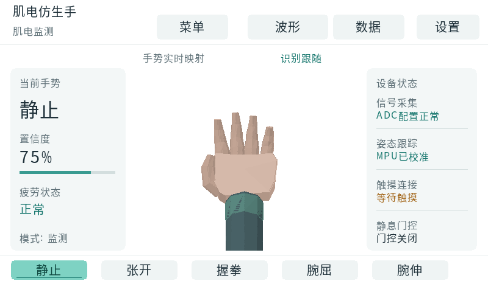
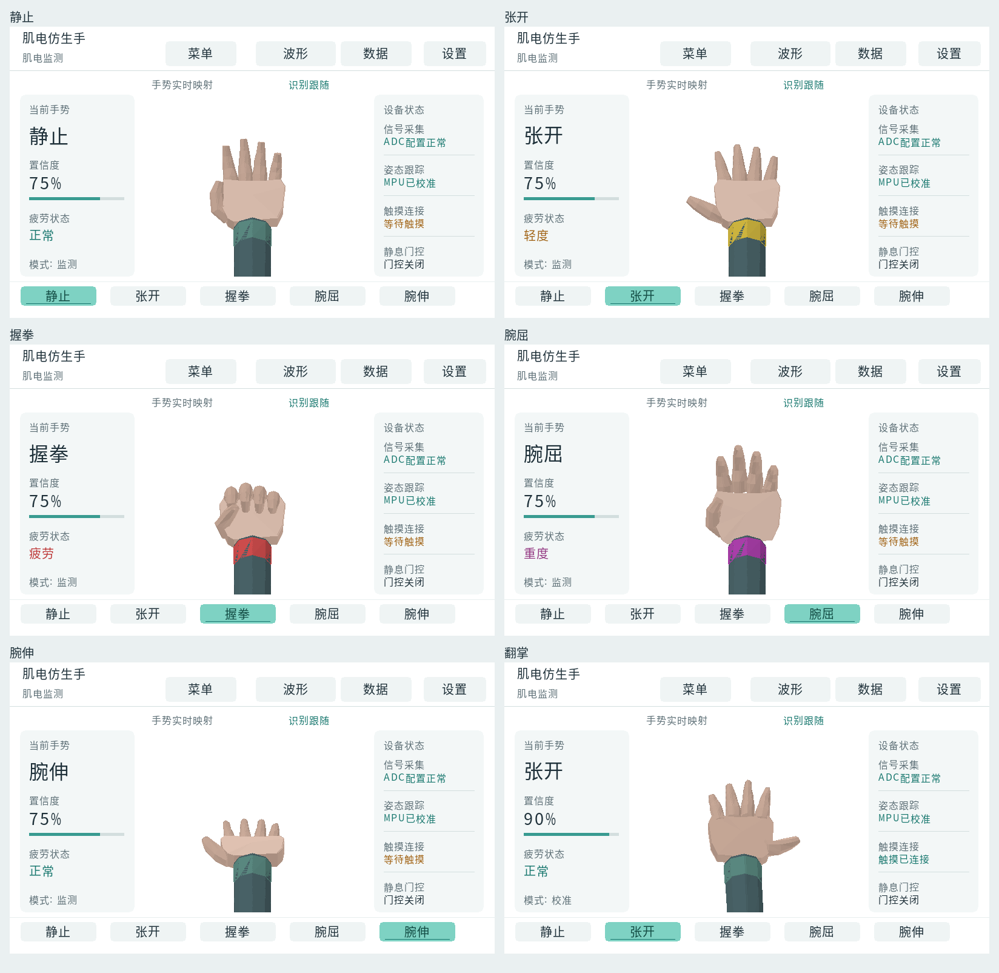
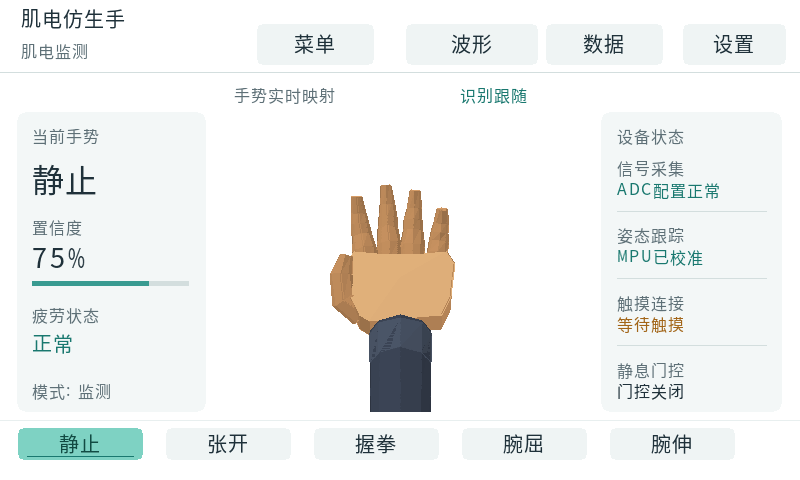
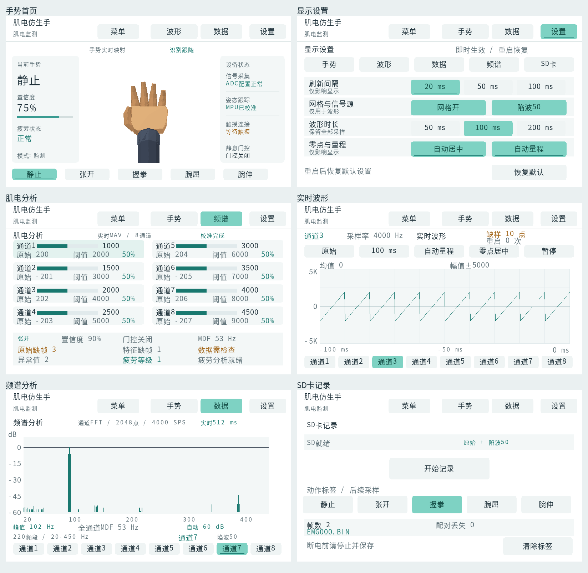
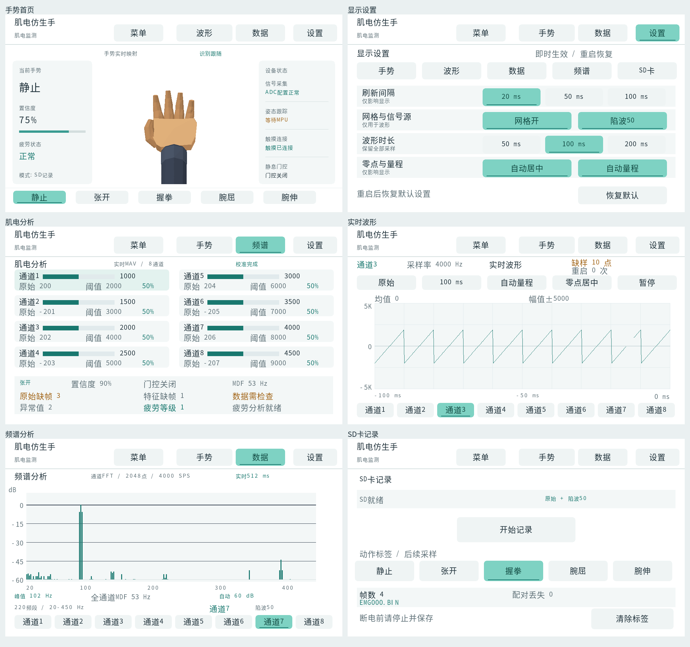

# 白底仪表盘与思源黑体

最新固件标识：`20261021_LCD_TEXT_BASELINE`。
中英文与数字基线修正记录见 `lcd_baseline_20261021.md`。
以下保留白底主题与手部配色的历史记录。

手部已由橙黄色改为低饱和暖米肤色：皮肤基色 `#D6B5A3`，掌心
`#E6C7B7`，并柔化光照阴影。袖管改为青灰 `#526E73`，正常腕带
改为灰绿 `#65988F`；疲劳腕带仍保持原有等级颜色。
已检查五种动作、手背及两种屏幕尺寸。LCD 回归、ARM 编译与 G1–G5
打包检查均通过。日志见 `lcd_skin_test_20261021.log`、
`lcd_skin_arm_20261021.log`、`lcd_skin_gates_20261021.log`；
最新产物校验见 `lcd_skin_artifacts_20261021.json`，下方白底方案原图作为历史记录。

采用用户确认的“A 仪表盘为主，结合 B 手势主体”布局，主适配 800×480，
同时支持 1024×600。白底、浅灰分区、青绿色选中态；警告使用深琥珀色，
错误使用深红色，并保留状态文字。参考图仅提供视觉依据。

首页左栏显示当前手势、置信度、疲劳状态与模式，中央显示原有三维手势，
右栏显示 ADC、MPU、触摸与门控状态，底部保留动作预览。
手势绘图先于侧栏，避免旋转后的模型覆盖状态文字。
波形、频谱、数据、SD、设置和菜单共用白底色板。
数据页的原始值和阈值标签已中文化，波形通道按钮使用中文。

## 字体与授权

LCD 原有微软雅黑字模已移除。中文、数字、英文单位与标点统一使用
Adobe 思源黑体简体中文常规体，来源和固定上游版本见
`third_party/fonts/source-han-sans/README.md`。许可为 SIL OFL 1.1，
支持商用与嵌入，分发时保留版权和许可说明。
完整字体保存在工具目录；固件只嵌入当前 UI 所需的 263 个字符。

字模由 `tools/gen_hz_glyphs.py` 使用 Pillow 从已固定版本的字体生成，
具有 16、20、24、32 像素四种原生尺寸，采用 4 位灰度覆盖率。
800×480 常规中文为 20 像素，1024×600 为 24 像素；辅助文字 16 像素，
主要识别结果 32 像素。使用背景混合改善边缘，UTF-8 测宽与绘制共用解码器。
同时补齐小写 `Hz`、`ms`、`dB` 和 `±`，避免单位缺字。

重新生成：`python tools/gen_hz_glyphs.py`，或运行原 PowerShell 入口。
生成不使用系统字体，也不会回退到微软雅黑。

## 验证与产物

- 两种分辨率 LCD 回归通过：页面路由、触摸、文本截断、UTF-8、
  灰度混合、字体越界保护、完整/局部渲染一致性、帧缓冲归属、
  波形、频谱、IMU、动作预览与 SD 状态保持。
- ARM 编译通过；仅保留供应商 FatFs 的既有未使用变量告警。
- UART 采集回归通过。
- 使用现有 PL 位流运行 `build/build_all.ps1 -SkipBuild`，G1–G5 全部通过。
  G4 引用现有布线结果，未重新综合或布线。
- `build/boot/BOOT.BIN` 已更新。许可证副本保存在
  `build/boot/SourceHanSans-OFL.txt`，分发时一并保留。

日志：`lcd_white_ui_test_20261021.log`、`lcd_white_ui_arm_20261021.log`、
`lcd_white_ui_gates_20261021.log`。产物校验见 `lcd_white_ui_artifacts_20261021.json`。

预览来自真实固件的主机绘图测试，输入为模拟数据；已检查两种尺寸的首页、
设置、数据、波形、频谱和 SD 页面。尚未上板，实际刷新速度、触摸手感和
屏幕显示效果需硬件确认。复用现有 PS 裸机绘图、三帧缓冲和触摸架构。

