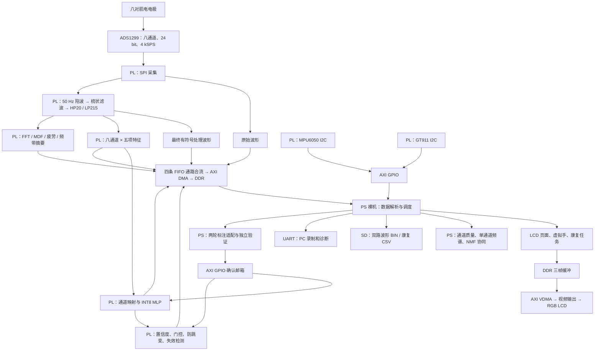

# 当前工程结构核对（2026-10-24）

> 历史快照：本文件核对时间早于当日 HDC 接入。后续已有 PS 板端学习与 HD000/HD001
> 实测，“没有板端学习”等下文表述仅反映当时状态。最新总体分工及开发边界以
> [工程总体框架 V1](system_framework_v1_20261024.md) 为准。

依据当前源码、Vivado XPR/BD、启动打包脚本及产物 SHA256 整理。本次没有修改运行代码、模型、引脚或 BOOT，没有重新编译或下载硬件。当前板上实际启动的是哪一份镜像，不能仅由本地文件确定。

## 总体结构

本工程是 **Zynq PL 实时肌电处理与五类决策 + PS 裸机显示/分析/康复任务 + PC 数据分析和离线训练**。当前没有板端新增类别学习引擎，没有已接线的机械手执行链。



PL 决策消费特征不等待 DMA 遥测 ready；DMA 堵塞会影响 PS 获取数据、显示和记录，并报告丢失，不能理解为所有支路都不会丢数据。

## 目录职责

| 目录 | 当前用途 | 需要注意 |
|---|---|---|
| `src/rtl/` | 手写 Verilog：采集、滤波、特征、推理、决策、FFT、FIFO、触摸/MPU、PWM 原语 | 存在已接入、兼容及独立模块，不能按文件存在判定启用 |
| `sw/ps_uart_print/` | 实际 Cortex-A9 裸机应用源码 | 名称沿用早期 UART 监控程序，当前已是整套 PS 应用 |
| `board/constraints/` | 引脚、时钟及 LCD 等 XDC | 当前 XPR 纳入四份 XDC，不能只看单一旧接线说明 |
| `build/vivado/` | 当前 Vivado 工程、BD 与综合/实现产物 | 主工程 `hand_motion_reconstruction.xpr`；BD 源码也在其中 |
| `build/scripts/` | BD 修改、功能回归、定向检查脚本 | 各脚本用途不同，不是所有脚本每次都运行 |
| `build/boot/` | BIF、配套镜像构建脚本、历史 BOOT 候选 | 文件名区分版本；普通 `BOOT.BIN` 不是最新候选 |
| `build/export/`、`build/vitis_ws/` | XSA、平台、FSBL 等生成内容 | 与 RTL/PS/镜像版本需要配套 |
| `tools/` | 录制、解码、波形分析、训练、量化导出、参考模型、审计 | 包含生产链工具和算法实验工具 |
| `sim/` | RTL testbench、PS C host 测试、Python 回归 | 不同层次的测试各有覆盖范围 |
| `data/` | 原始数据、模型、MEM、指标、首轮康复原件 | 原始波形也有大量放在 `report/emg.../` 中，尚非统一数据目录 |
| `report/` | 分批数据分析、验证记录、图片、产物摘要和实验结果 | 含多个历史版本，不能全部视为当前实现 |
| `src/bd/`、`src/hls/`、`src/ps/` | 当前为空目录 | 现阶段实际硬件没有 HLS 核心，PS 实现在 `sw/` |
| `tmp/`、根目录仿真/渲染文件 | 调试和生成内容 | 不作为当前实现入口 |

## 实际硬件入口与模块

当前综合源集 `sources_1` 的 TopModule 是 **`design_1`**，不是 `hand_motion_top`。

BD 文件：`build/vivado/hand_motion_reconstruction.srcs/sources_1/bd/design_1/design_1.bd`。

| 层次 | 当前模块及作用 |
|---|---|
| BD 肌电实例 | 实例名仍为 `emg_pl_export_0`，实际 module_ref 为 **`emg_pl_control`** |
| 控制适配器 | `emg_pl_control.v`：PS 命令/状态跨时钟确认邮箱，启用 `CONTROL_ENABLE=1` |
| 肌电集成层 | `emg_pl_export.v`：ADS1299、共享滤波、特征、推理/决策、疲劳及导出集成 |
| 采集 | `ads1299_spi.v`：初始化、寄存器状态和八通道采样 |
| 共享滤波 | `emg_line_filter.v` → `emg_notch50.v`、`emg_comb50.v`、`emg_bandpass.v` |
| 窗口特征 | `emg_feature_bank.v`、`emg_window_features.v`；当前旁路其重复带通 |
| 推理与决策 | `emg_control_inference.v` → `emg_nn_infer.v` + `emg_control_policy.v` |
| 疲劳/频域摘要 | `emg_fatigue.v`：八通道分时 2048 点 FFT、MDF、历史斜率、等级确认、30 段摘要；内部仍有本支路高通 |
| 数据导出 | `emg_data_path.v`、`axis_async_fifo.v`、`axis_packet_mux.v` |
| 触摸 | `touch_gt911.v` → AXI GPIO → PS |
| MPU | BD 实例 `mpu6050_tilt_0` 实际引用 `mpu6050_motion.v`，内部复用 `mpu6050_tilt.v`，输出六轴快照 |
| 显示 | AXI VDMA、AXI4-Stream 视频输出、`lcd_panel_adapter.v`、`lcd_clk_fwd.v` |

当前 EMG 采集/滤波/推理/决策逻辑接 `pl_clk`，为 25 MHz；AXI/DMA 接 PS FCLK0 100 MHz；触摸、MPU、面板适配输入接 FCLK1 50 MHz。面板适配还会选择实际像素时钟，不把 50 MHz 一概视为 LCD 像素时钟。

`hand_motion_top.v`、`ads8698_spi.v` 等仍保留历史/替代路线；`hand_servo_pwm.v` 作为独立原语存在于工程源文件中，但没有接入当前 BD 的执行链。旧注释中的“100 MHz 下推理耗时”“另一套顶层”不直接代表当前 BD。

## 数据契约

| 项目 | 当前约定 |
|---|---|
| 肌电输入 | 8 通道，24 bit 有符号，4 kSPS/通道 |
| 最终波形 | 50 Hz/Q10 陷波 → 50 Hz 间隔、约 1 Hz 齿宽梳状滤波 → 20 Hz 高通 / 约 215 Hz 低通 |
| 特征窗 | 400 点（100 ms），步长 100 点（25 ms），每秒 40 窗 |
| 模型输入 | 40 项：MAV×8、WL×8、Energy×8、ZC×8、SSC×8；RTL/导出量化契约需一并保持 |
| 当前分类器 | INT8 MLP，40→64→32→5 |
| 五类推理 ID | 0 放松、1 张手、2 握拳、3 屈腕、4 伸腕 |
| 适配环顺序 | CH4→CH1→CH2→CH3→CH5→CH6；CH7/8 不参与环移 |
| AXI 数据 | 64 bit，含 type/channel/id/sequence/payload |
| 遥测类型 | 1 raw、2 feature、3 推理/决策、4 疲劳/频域摘要、5 最终 processed |
| 最终决策 | type3/id6；id0–4 是 logits，id5 是原 argmax，不能替代最终决策 |
| DMA 批次 | 1024 个 64 bit 字，8192 B |
| FIFO | raw、processed、feature、result 四条通路；type4 与 type3 共用结果通路 |

线上特征按通道及特征 ID 解析，模型向量则整理成 feature-major。扩展算法应复用完整窗口的 `feat_vals`，不能未经重排直接把包到达顺序当作模型输入顺序。

## PS 裸机应用

实际入口 `sw/ps_uart_print/main.c`。通过 ARM GCC 直接构建，包含启动汇编、链接脚本及 Xilinx SD/FatFs 源码，当前没有 Linux/RTOS。

| 功能 | 主要文件/位置 | 当前边界 |
|---|---|---|
| 调度、MMIO、DMA、包解析 | `main.c` | 主循环和多个功能汇集于此，尚未完全拆分 |
| PL 命令与最终决策接收 | `pl_control.h`、`main.c` | PL-control 构建采用 PL 最终决策；兼容构建仍保留 PS 判决 |
| 静息校准 | PL policy + PS 镜像显示/触发 | 更新门控基线，不新增类别或训练权重 |
| 标注适配 | `selfcal.h`、`main.c` 自校准页 | 两轮采样，选择六种环移候选并独立验证，不是完整 SAL 连续优化 |
| 虚拟手 | `pose_contract.h`、`lcd_hand_3d.h` | 类别姿态表和平滑运动；不等于逐手指真实关节测量 |
| 前臂运动 | `lcd_imu_3d.h` | 六轴姿态估计、校零、约束模型；没有真实空间位置积分 |
| 界面与波形 | `lcd_ui.h`、`lcd_waveform.h`、`lcd_settings.h`、`lcd_font_zh.h` | PS 绘制，DDR 三帧缓冲，VDMA 扫描输出 |
| 单通道详细频谱 | `main.c` 的 `lcd_spectrum_fft()` | **PS 自算** 2048 点 Hann 窗 FFT，显示约 20–450 Hz 的 220 个 bin |
| 通道质量 | `channel_quality.h`、`lcd_channel_quality.h` | 对最终处理波形统计 RMS、峰值因子、定频占比；不是接触阻抗测量 |
| NMF 协同 | `synergy_nmf.h`、`synergy_nmf_model.h` | **PS 固定 W** 求 C；普通运行中不在线学习 W |
| 协同平滑/握拳参考 | `synergy_feedback.h` | 相对肌电活动反馈，不是测得的牛顿力 |
| 康复任务 | `rehab_training.h`、`lcd_rehab.h` | 单动作与四动作顺序循环，统计保持、响应、中断和完成情况 |
| SD 记录 | `sd_record.c/.h` | `EMGnnn.BIN` 保存同序号 raw+processed；`RHnnn.CSV` 保存训练结果 |
| 手动标签 | `capture_actions.h` | 由 Python 定义生成，14 类采集标签；不是推理类别扩容 |

频谱计算有两条用途明确不同的实现：PL 提供八通道疲劳及粗频带摘要，PS 从所选通道最终波形生成详细频谱图。后续优化计算量时需同时考虑两者。

康复页的“四动作组合训练”指四动作依次完成；14 类采集中的“组合手势”指握拳同时屈腕等复合动作，两者不能混用。

## PC 工具与模型链

```text
SD BIN ── decode_sd_record.py ── raw/processed CSV + JSON
UART ──── record_uart.py ────── CSV + JSON
                        │
                        ├─ analyze_capture.py：信号质量/频谱/分段分析
                        ├─ train_board_model.py：现有五类训练与验证
                        │    └─ export_board_int8.py / export_int8.py → MEM → PL
                        ├─ train_gesture_model.py：14 类离线候选，尚不能直接装入当前 PL
                        ├─ nmf_validate.py / export_synergy_model.py：协同实验与固定基底导出
                        └─ hdc_validate.py / audit_hdc.py：HDC 离线实验与协议复验
```

当前 RTL 默认权重：`data/models/nn_int8_board_multiwear/nn_int8_weights.mem`。五类模型来源及指标在 `report/emg008_009_model_20261022.md`、`report/pl_model_fatigue_update_20261022.md` 和对应 `data/metrics/` 中；早期 NinaPro 指标不能当成当前真实佩戴准确率。

`tools/capture_actions.py` 是 14 类人工采集标签定义源。推理 ID 为 0–4，人工标注 ID 为 1–14、0 表示未标注，**两种编号不能直接互用**。

HDC 本轮只有 Python 实验与审计；没有 ARM 在线分类/学习、PL 引擎、LCD 教新手势流程或模型持久化。14 类同样只有采集与离线候选训练能力，未部署 14 类模型。

## 构建、启动与验证

| 事项 | 当前入口 |
|---|---|
| Vivado 工程 | `build/vivado/hand_motion_reconstruction.xpr` |
| PL 构建与门禁 | `build/build_all.ps1`、`build/project.psd1`；PL 改动后先运行 `-SkipBoot` 完成实现与硬件门禁 |
| PS 编译 | `sw/ps_uart_print/build.bat --pl-control` → `ps_uart_print_pl_control.elf` |
| 当前配套 BOOT | `build/boot/build_pl_control_boot.ps1`，先验已有硬件，再编 PS、打包及核对 |
| 分区定义 | `build/boot/boot_image_pl_control.bif`：FSBL + `design_1.bit` + PL-control ELF |
| 产物校验 | `tools/verify_control_boot.py`，核对硬件接口、应用标签和镜像加载段 |
| 测试 | `sim/` 的 RTL/C/Python；`build/scripts/run_*_test.ps1` 等提供各功能入口 |

通用 `build_all.ps1` 的普通打包配置仍指向兼容 ELF `ps_uart_print.elf`。当前应使用专用 PL-control 配套构建流程，不能仅认为“运行任意构建脚本都会生成最新同版镜像”。

最新本地命名候选：**`build/boot/BOOT_20261023_GESTURE_CAPTURE_V1.BIN`**，4,920,076 字节，SHA256 `c7ed8c425b03794d63086b6aedda4ceae48ad72a10ee56accb4b6bd1681b38c4`。

已逐项核对 `report/gesture_capture_20261023/artifacts.json` 中 24 项产物/源码，当前摘要均匹配。它包含已有质量检查、自校准、协同、康复和握拳反馈及新采集标签。普通 `build/boot/BOOT.BIN` 仍是 4,733,316 字节的旧候选。硬件验证记录仍为 `hardware_verified=false`，机械手连接为 `pwm_connected=false`。

已记录布线资源：LUT 38,368/53,200、FF 34,002/106,400、Slice 12,467/13,300（93.74%）、BRAM 29.5/140、DSP 95/220；WNS +0.320 ns、WHS +0.002 ns。该数值属于已有整机实现，不自动覆盖将来的新增算法；全系统 CDC 仍存在待核对告警。

## 后续在线学习的接入边界

- **可复用**：完整 40 项特征、八通道 MAV、质量检查、LCD 引导采样、两轮验证框架、SD 文件服务。
- **候选验证位置**：先在 PS 完整特征窗口到达后旁路运行原型/LDA/HDC，记录新旧候选，保留当前 PL 决策权。
- **需要新增**：类别注册、标签确认、模型训练/更新、拒识、独立验证、版本化存储和撤销；当前任何一个校准功能都不能直接替代这些能力。
- **真正启用前**：必须明确最终决策如何与现有 PL policy 协作。只改 LCD 显示类别，不等于康复状态机和执行端已经采用新类别；现有五类 ID/字段/姿态契约也需同步评估。
- **机械手另行集成**：已有 PWM 原语尚无顶层连线、XDC、经过校准的动作脉宽表，也没有实际位置反馈。新增分类不能直接宣称完成机械手动作。

## 本轮发现的结构问题

1. 主 README、`board/README.md`、部分 RTL 注释混有旧顶层、旧速率/耗时和历史模型说明。此文件明确当前入口，尚未批量改写历史文档。
2. BD 存在 `build/vivado/` 下；`src/bd/` 为空。应保留实际 BD 源码与生成物的区别，当前没有迁移目录。
3. `main.c` 同时承担解析、调度、算法、页面和存储协调；头文件中也有静态实现，后续扩展宜先沿用其边界，再按测试覆盖逐步拆分。
4. 数据、分析结果、历史镜像与实验工具数量较多，工作区还有未提交改动；不能仅凭最新 Git 提交重现当前全部功能。
5. 当前功能完整度分为“已接入运行链”“独立仿真模块”“PC 算法候选”三个层次。新增在线学习应保持这个区分。

机器可读核对结果见同目录 `project_structure_20261024.json`，记录 BD 模块、地址、关键文件摘要、候选镜像匹配结果及 Git 状态。
