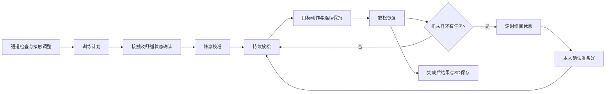

# LCD导航、康复训练与通道质量评分 V4

日期：2026-10-25。适用对象由用户确认：科研演示与健康人验证，预留治疗师配置。
固件：`20261025_HAND_CONTROL_REHAB_V4`。沿用已验证的 PL、滤波、模型、PWM 接口，并在通道检查页增加实时 0–100 分及 A–D 等级。原 V3 镜像保留，可用于回退。

## 已实现的操作流程

上电进入首页。固定顶栏为「首页 / 返回 / 训练 / 设置」，机械手忙时右上角优先显示「停止」。
首页集中提供实时监测、康复训练、通道检查、波形、频谱、协同、SD记录标注、自学习和机械手控制。
首页下方单独放置「监测模式 / 串口记录 / 静息校准 / MPU归零」操作，避免把页面、校准动作和采集模式混为一谈。
“模式”文字只显示真实的监测或串口记录后端。通道检查入口固定进入质量子页。

| 操作 | 规则 |
|---|---|
| 返回 | 常规页面返回首页；机械手、自学习、佩戴适配返回设置；首页返回实时监测 |
| 离开训练 | 立即暂停，保留本次计划及已完成结果；回到训练页显式恢复并重新校准 |
| 离开学习/适配 | 取消正在采集的未完成样本；已提交的学习记录依现有机制保留 |
| 离开机械手或切换采集模式 | 立即清除待发动作并请求PL停止，不自动恢复输出 |
| SD波形录制时切页 | 录制继续，首页提示SD记录状态；必须回到SD页停止保存 |
| 开始训练 | 必须先停止SD波形记录，处于监测模式且PL/静息校准就绪，完成两项人工确认 |
| 同时点击开始和切页 | 取消未执行的启动/恢复请求；结束和结果保存请求保留 |

所有生产页面标志统一由 `ui_open_page` 设置，避免之前波形页未清数据/频谱标志导致的显示、触摸错配。
串口 `w/a/s` 快捷键仍保留，转入相同页面管理入口。暂停的训练不阻止进入自学习；两者不同时采集训练证据。

## 本轮康复流程

1. 首页「通道检查」直接显示每通道总分、A–D等级、四项简写分项和 RMS/工频族数据。分数在采集3秒静息参考后计算，只有同一佩戴和静息条件下才适合比较。点击“波形分析”可进入原波形/频谱页。

### 通道分数的含义与网站规则对照

已核对 EMG Lab 的公开 `quality.js` / `step-quality.js`：网页使用四个质量分项等权平均，按 80/60/40 划分 A/B/C/D，再根据最弱分项封顶。LCD 借用了这套评分结构，但不能直接复刻网页算法：板端只有最终带通处理后的 4 kSPS 波形和用户静息参考，没有网页需要的宽带数据及 SNR、2–20 Hz 原始低频等统计量。

板端的四个等权分项为：

| 分项 | 依据 | 解释 |
|---|---|---|
| 活 | 当前 1 秒 RMS 相对静息基线 | 低于基线 25% 得 0 分，低于 50% 得 80 分，其余正常范围得 100 分；超过基线 2 倍得 80 分，提示活动/噪声已偏离静息条件 |
| 工 | 50、100、150、200 Hz 窄带功率占最终处理波形总功率比例 | 占比 ≤2% 得 100 分，≥20% 得 0 分，中间线性扣分 |
| 尖 | 峰值因子（去直流峰值 / RMS） | ≤10 得 100 分，≥30 得 0 分，中间线性扣分 |
| 顶 | 最终处理波形是否触及近满量程 | 未触及 100 分；近满量程为 0 分并强制 D 级封顶 |

四项平均分按 ≥80 / ≥60 / ≥40 / 更低映射 A/B/C/D；任一分项低于80、60、30分时，等级最高分别限制为 B、C、D。没有连续数据或没有完成三秒静息参考时显示“数据不足”，不生成猜测分数。

这是用于辅助电极调整的工程相对评分。分数不是网站的同分指标，不测电极阻抗、不能证明未处理的 ADC 是否削顶，也不是医疗/临床等级。静息基线必须在同一次佩戴、相同放松姿势下采集；动作期间活跃幅度增加可能使分数下降，不能据此判定电极接触变差。
2. 「训练」先设置单动作或四动作组合、次数、连续保持和每次放松时间。默认不启用握拳活动范围要求。
3. 「下一步 / 检查」进入准备页。分别确认电极/波形和舒适状态，选择组间休息；未完成条件时不会开始。接触与舒适属于人工确认，不是软件诊断。
4. 开始后再次静息校准，再按「放松 → 目标动作 → 连续保持 → 放松恢复」运行。姿势采用舒适幅度，不要求最大用力；识别失败应先排查接触和模型泛化。
5. 单动作每3次为一组，组合训练每4个动作一组。组数按计划计算，不额外增加动作；最后一组完成后进入结果。中间组默认休息15秒，可选30/60秒，计时结束需点击「我已准备好 / 继续」，不会自动推入下一组。这些时间是演示选项，不是临床处方。
6. 组间休息也监测数据新鲜度；断流暂停。组末恢复期或组间休息时离页，再恢复都不会绕过组间休息。
7. 训练期间「暂停训练」保留计划；「结束并查看结果」终止本轮并保存已有结果。出现不适时停止；不以MDF疲劳等级自动加量。

可选的握拳活动反馈继续使用舒适抓握 C2 参考的80%–120%。C2是相对肌电活动，不是握力、MVC百分比或关节角。
本次未降低PL置信度、放松门控或连续证据要求来提高分数。

结果页保持成功次数、超时、计划完成率、识别响应、保持中断和逐动作计数。响应包含识别算法与窗口延迟，不能当作神经反应时。
SD `RHxxx.CSV` 新增研究使用范围、组长度、组间休息、已完成组间休息数、暂停数、人工确认字段；继续保存逐次任务结果、模型说明、基线和C2参考。
`active_elapsed_ms` 为排除暂停后的会话时间，仍包含校准、放松和组间休息，不等于肌肉收缩时间。

## 更贴近康复使用的后续方案

采用「个人目标—基线评估—按任务练习—节奏休息—过程反馈—复评」主线，避免只追求分类准确率或更用力发力。

| 层次 | 建议设计 | 当前边界 |
|---|---|---|
| 个人与计划 | 佩戴批次、训练侧、目标、动作范围、次数/保持/休息、计划版本 | 当前有临时计划与CSV记录，人员档案和计划持久化待做 |
| 运动启动练习 | 单动作、较短保持，反馈动作启动与充分放松，区分识别失败和没完成动作 | 已有单动作及保持/放松逻辑；自动区分两种失败还缺外部真值 |
| 稳定保持练习 | 舒适活动范围内稳定保持，反馈中断与完成，不自动抬高目标 | 已有连续证据与可选握拳活动范围；无临床负荷估计 |
| 协调与切换练习 | 从单动作到四动作序列，再到功能任务，如张开—抓握—释放 | 已有固定四动作序列；自定义序列和真实抓取任务待做 |
| 主观反馈 | 训练前后记录不适/疲劳感，训练中可随时停止，明确停止原因 | 当前有舒适确认、暂停/结束；分级主观量表与停止原因表单待做 |
| 治疗师配置 | 按人审批计划与最大范围，锁定参数，版本追踪；每次变化可审计 | 当前为工程参数界面，未实现治疗师身份、锁定、处方导入，不能声称已有治疗师模式 |
| 机械手辅助 | 单独使能，记录命令、限速、超时；实际到位与力反馈另接传感器 | 当前六路PWM无实际角度/接触力闭环；本轮训练不自动启动机械手，也不作为人体辅助驱动 |
| 随访比较 | 同佩戴条件复测，分别展示任务成绩、信号质量、主观感受，按天比较 | 当前CSV逐会话可比较，LCD历史曲线、个人档案待做 |
| 临床量表 | 如需FMA-UE、ARAT等，应由有资质人员按标准施测并独立记录 | 当前EMG识别结果不能自动换算成这些分数 |

与医学康复关联的设计原则参考已核对的[NHS卒中恢复说明](https://www.nhs.uk/conditions/stroke/recovery/)：个体化恢复计划、由医疗团队协助设定目标、运动训练与疲劳/心理支持、持续复评。
此页面不支持把本工程参数认定为卒中治疗剂量，也不验证本设备的疗效。NICE NG236正文读取返回403，本次未引用未读取内容。

## 验证与上板检查

已通过的主机验证与构建记录见 `validation.json`、测试日志与 `artifacts.json`；预览来自真实C固件渲染，不是UI设计图。

- 800×480和1024×600：真实触摸、字体、完整/增量帧一致性、三缓冲边界、121种页面组合。
- 训练引擎：连续动作证据、放松、重复/缺帧、断流、超时、暂停、时钟回绕、组末暂停与显式组间继续。
- PL固件模拟：PL决策权威性、动作与特征同窗匹配、页面/后端切换清空机械手动作队列。
- SD/UART与机械手固件回归：文件保存、错误处理、双波形源、标定CRC与停止优先级。
- ARM编译、既有PL验收门、XSA/bit一致性、ELF和BOOT逐段匹配。

尚未连接实板验证触摸响应、SD实卡或机械手，也没有健康人实验或临床验证结果。
上板建议先验证：首页九入口及返回 → SD录制中切页再停止 → 训练前条件拦截 → 三次短单动作 → 组合训练中途离页/恢复 → 第二组前等待并显式继续 → RH结果读取。

V4-LCD布局收敛为“总分/等级 → 四项分数 → 当前通道指标 → 静息参考状态”；LCD不再重复显示算法说明和免责声明。必要的分数限制、数据边界和工程用途说明保留在本报告中。

新版镜像路径：`build/boot/BOOT_20261025_HAND_CONTROL_REHAB_V4.BIN`。复制到启动卡时命名为 `BOOT.BIN`；V3及更早镜像保留用于回退。
