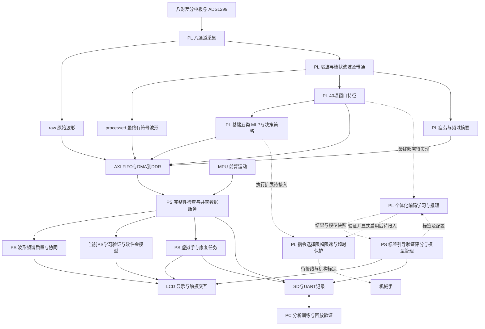

# 工程总体框架 V1

2026-10-26 更新：本页保留 10 月 24 日的总体目标与历史边界；当前计算分工以
[NMF/HDC 迁入 PL 的实现与验证](pl_learning_nmf_20261026/README.md)为准。
PL 已追加固定基 NMF 系数求解、HDC 训练范围统计、编码、原型更新、分类及间隔值计算；
PS 保留标签/采样流程、DDR 模型管理、验证评分、质心对照、结果稳定与机械手映射调度。
下文关于 PS 学习核心的说明属于迁移前记录，不表示新版仍在 ARM 上执行 HDC 或 NMF 核心运算。

日期：2026-10-24。用于确定后续开发边界；下文明确区分现有实现与待完成设计。本次只整理架构文档，没有修改固件、RTL、模型、引脚或 BOOT。

最终部署要求：**个体化学习的特征变换/编码、训练参数与原型更新、推理、拒识和稳定决策均落在 PL**。当前 PS 学习器作为算法验证阶段与软件金模型保留。PS 最终承担交互、流程控制、验证评分及模型文件管理。

同日补充定案：**先在现有链路上追加完整功能并保存基线，再优化并对比**；自定义手势支持 **LCD中文拼音命名** 和 **用户配置机械手目标映射**。具体交付及对比边界见[完整功能与优化对比约定](full_feature_baseline_20261024.md)。这些为待实现要求，不表示当前BOOT已经支持。

## 1. 项目定位与主线

保留作品名称 **基于 FPGA 的表面肌电手部运动重建与康复训练系统**。

工程主线为：**佩戴与信号检查 → 肌电/前臂运动采集 → 实时处理与意图识别 → 虚拟手反馈和康复训练 → 记录与评估**。数据分析是贯穿主线的基础能力，自定义手势学习是个体化扩展，机械手是独立执行扩展。

固定三项产品能力：

1. **独立康复训练终端**：电池供电，LCD 完成设置、反馈、任务和结果查看，SD 保存结果；常规运行不依赖 PC。
2. **肌电采集与分析终端**：查看波形、频谱、通道质量、活动分布、疲劳趋势，进行人工动作标注并保留 raw/processed 对照。
3. **个体化手势学习终端**：用户明确教新类别，板上学习、独立验证和重测；效果达标后再选择用于交互。算法允许替换，不将“自学习”绑定为必须使用 HDC。

“运动重建”采用动作类别对应的虚拟手姿态与 MPU 前臂方向估计。当前没有逐指连续关节角真值，没有单 MPU 测得的真实手部空间轨迹。“康复评估”表示识别支持的任务完成、保持、响应与相对活动反馈，不扩展为临床疗效诊断。

## 2. 系统分层

实线表示已有主要功能关系，虚线表示待完成的 PL 个体化引擎及执行接入。PS“共享数据服务”是对现有解析、完整窗口和调度职责的逻辑归纳，不表示已经新建了一个独立软件模块。MANAGE 表示最终管理职责，现有学习页只覆盖其部分流程。当前 HDC 不进入 APP 判定或 EXEC。

## 3. PS / PL / PC 分工定案

| 位置 | 固定职责 | 划分依据 |
|---|---|---|
| PL | ADS1299 采集、统一滤波、窗口特征、基础 INT8 MLP、基础门控/稳定/失效决策、疲劳频域摘要、FIFO/DMA 数据输出 | 连续流、确定时序、避免显示或存储参与基础判决 |
| PL 个体化引擎（最终目标） | 特征变换/编码、训练范围统计与参数建立、原型更新、个体化推理、拒识及稳定决策 | 学习和识别的核心计算在PL闭合；当前PS实现用于确定算法并作为金模型 |
| PL 执行扩展 | 目标原子提交、PWM、机构行程/速率约束、数据新鲜度与超时保护 | 控制脉冲与保护不能依赖 UI 刷新；当前仅有独立 PWM 原语，整链待实现 |
| PS | LCD/触摸、MPU姿态与虚拟手、详细频谱、质量统计、NMF活动反馈、康复任务、适配/学习流程、用户标签、验证评分、模型存取及报告 | 当前暂跑学习算法用于验证；最终只管理PL学习任务与模型，不承担逐窗学习/推理核心计算 |
| PC | BIN解码、完整波形分析、离线训练与量化、算法回放、跨佩戴验证、产物审计 | 保留充分数据和分析能力，不成为独立训练终端的运行依赖 |

保留 Cortex-A9 裸机与现有构建方式。当前路由实现 Slice 占用约93.74%，不能根据 LUT/BRAM 尚有余量就假设新增 PL 引擎容易布线。**PL 化为已确定的最终目标**；PS 对照用于先收敛算法。按用户确定的顺序，先保持既有深FIFO、特征和滤波组织，追加完整功能，综合/实现并保留资源、时序和行为基线，再进行资源优化。新学习模块可正常使用BRAM及串行运算，不为制造高资源基线而故意全维展开。若完整版无法布通或不满足时序，先保留失败证据，再进行使其可运行的必要调整，并明确区分原始追加版与可运行基线；不得把失败实现作为可上板版本。最终仍须全工程实现确认，不承诺未经测量的资源与时序。

基础决策不等待 PS 遥测消费；DMA拥塞仍可能丢失导出数据、影响PS应用，不宣称全系统永不丢数据。

## 4. 两条识别路线与唯一动作来源

### 基础路线

`PL 40项特征 → 已部署五类MLP → PL门控/置信度/时序稳定/失效检查 → 基础最终动作`。

当前康复和虚拟手使用该路线的最终动作。保留五类：放松、张手、握拳、屈腕、伸腕。既有通道环移适配使用显式命令及确认，不让候选自动覆盖已验证配置。

### 个体化路线

当前验证路径：`共享特征 → 用户标签采样 → PS候选学习 → 冻结模型 → 另做动作验证 → 实时预览`。

最终部署路径：`PL特征 → PL变换/编码 → 根据PS确认标签在PL更新候选模型 → 冻结候选 → PL验证推理 / PS评分 → 显式激活 → PL个体化推理与稳定决策`。PS经确认的标签和配置进入PL，PL处理完整特征窗；最终运行不要求每个窗口先送到PS算出编码或原型再写回。

当前有 HDC 与缩放质心对照，输入为八路 MAV；这不是与40维 MLP 完全同构的模型。多原型、幅度/空间分布表示、HDC评分方式、其他轻量分类器属于待比较的算法，不在本轮指定胜者。

HD001：HDC八类609/640=95.16%，质心624/640=97.50%；自定义类别为竖拇指、比六、OK。每类只有两次验证，且窗口重叠。它支持继续推进在线学习，不足以宣布 HDC 最优或跨佩戴已稳定。见[实测分析](hd001_20261024/README.md)。

### 最终动作的使用规则

- 基础模式仅采用 PL 基础最终动作；自定义验证模式只展示候选和统计，不控制执行器，也不写入基础康复成功判定。
- 后续启用自定义交互时，用户明确选择基础/个体化来源，再输出唯一的“已接受动作”。不按“本次HDC擅长屈腕、下次质心擅长比耶”手工拼结果。
- 用户切换来源、重新学习或加载模型时，旧动作先失效；新模型须具备匹配类别映射和新鲜数据。未知/不确定与放松保留不同语义，失效不能伪装成完成放松任务。
- LCD动作预览、康复目标提示、人工采集标签、真实识别结果分别记录；示范动画与提示不得成为机械手控制命令或真值标签。
- 最终基础/个体化两类识别结果都由PL产生，唯一来源选择与互斥约束在PL落实。PS只配置模式和类别映射，不逐窗转发个体化预测才能驱动执行。新增类别需要独立、版本化的结果契约及验证，不能复用旧五类ID强塞进现有决策字段。

以上是未来接入约束，当前并无已经启用的双模型仲裁器或新执行寄存器。

### PL 学习引擎的实现边界

1. 学习仍由用户确认动作标签。PS发送开始/取消/结束、类别和模型配置，PL在完整窗口边界接收并回报确认；不允许旧标签误套到已排队的另一次动作。
2. 训练阶段由PL建立量化/归一化参数及原型；若算法需先统计范围再编码，则由PL保存/重放所需训练特征。验证和自由识别阶段冻结模型，不用测试标签更新。
3. 保留已激活模型与候选模型的隔离，部分采样失败不提交；验证完成由PS显式请求激活，PL原子切换并回报模型版本。PS负责评分与用户流程，PL负责实际模型状态和完整性约束。
4. PS从PL导出一致的冻结模型快照保存SD，加载时校验格式/语义后写入候选存储，完成传输及校验才可激活。不得边加载边使用半个模型。
5. 训练、推理、模型传输明确仲裁，不阻塞采集及基础决策。模型计算完成时间、窗口新鲜度、训练溢出及超时状态可观察；异常时取消本次学习或禁止采用个体化结果。

HDC若最终采用D2048、int16、8类，单原型数组原始容量为32KiB；每类三个原型则96KiB，活动/候选各一套原型为192KiB。这些仅为原型数据字节数，不含编码内存、训练缓存、端口/位宽造成的BRAM分配和其他状态，更不代表资源实现已通过。并行度、原型数量、定点格式和存储组织在算法收敛后冻结；接口具体寄存器另行设计，复用现有确认邮箱经验。

## 5. 统一数据与模型契约

| 数据 | 冻结约定 | 用途 |
|---|---|---|
| raw | 8通道，24bit有符号，4kSPS/通道 | 原始存档、干扰和ADC范围诊断 |
| processed | 同序号的最终有符号处理波形：50Hz陷波→梳状→HP20/LP约215 | 识别、屏幕波形及处理后分析共用源 |
| 特征 | 400点窗、100点步长，40窗/秒；MAV/WL/Energy/ZC/SSC各8项 | 基础MLP与学习分支共用完整窗口 |
| 基础决策 | 现有 type3/id6；原始argmax/logits另存 | 成熟五类主链的有效输出 |
| 人工标签 | 现有14类人工采集标签；与推理ID独立 | 离线监督数据；自定义语义另需会话字典 |
| 时间与完整性 | 来源、样本/特征序号、缺口/超时信息 | 对齐、拒绝损坏片段、解释延迟 |

人工标签 ID 与推理 ID 不互用。HD001 的 custom1=竖拇指，HD000 的 custom1=比耶，说明 custom1 只是模型内槽位，不能成为跨会话固定动作名称。

后续模型包须同时保存类别语义、模型版本、特征顺序/滤波版本、训练归一化参数、原型或权重、通道布局/映射和验证摘要。文件需版本校验与完整性校验；加载失败保留上一有效配置。当前 HDC 模型仍只有RAM，HD CSV只保存验证汇总，此处为待实现要求。

自定义类别名称由用户在LCD中文拼音键盘输入，支持重命名并同步用于教学提示、结果、报告及模型恢复；PS管理UTF-8名称、拼音候选和字体，PL只使用稳定类别标识。现有编译字库只是界面字符子集，不能声称已覆盖用户中文输入。候选词库与新增字形资源通过SD提供，并纳入版本/缺失资源检查；无需PC或联网输入名称。

类别另绑定可配置的机械手六路目标姿态及执行开关。名称、类别标识、目标映射和机构标定引用一并持久化，重命名不改变类别或目标；替换模型不能按“自定义1”槽号静默继承另一手势的执行映射。PS编辑，PL在完整配置校验后原子应用目标表；逐窗自动执行不经过PS重新判断。详细边界见[交付约定](full_feature_baseline_20261024.md)。

PS共享解析后的数据，不为每个LCD页面另造采集或滤波链。频谱的显示归一化只用于绘图，不改变保存数据或模型输入。

## 6. 功能与界面组织

按使用流程组织，而非按算法名堆页面。以下为导航规划，可逐步复用现有页面实现：

| 功能组 | 页面与任务 | 现状及下一步 |
|---|---|---|
| 佩戴准备 | 通道质量、放松基线、必要时通道适配 | 已有；质量分数辅助排查，不等于接触阻抗 |
| 实时监测 | 虚拟手、动作来源、活动条、MPU前臂方向 | 已有基础功能；来源/无效状态需持续明确 |
| 数据分析 | raw/processed单通道波形、频谱、各通道活动、NMF与疲劳趋势 | 已有；相对C不称为抓力，疲劳不称为临床结论 |
| 康复训练 | 单动作、四动作依次训练、保持/休息、握拳相对强度目标、结果 | 已有；首先提升轻用力与动作边界的可靠性 |
| 个体化 | 手势字典、中文拼音命名、分次学习、独立验证、重测、模型管理 | PS版HDC/质心引导学习与报告已有；命名、最终PL学习/推理、多原型、逐窗日志、持久化待做 |
| 数据记录 | SD双路波形、人工标签、会话信息、导出 | raw/processed与14类标签已有；自定义语义字典待补 |
| 设备与执行 | 校准、显示设置、版本诊断、逐手势目标映射、机械手状态 | 设置已有；映射编辑和执行状态页随实际机械手集成新增 |

疲劳反馈后续按有效肌电活动和可比任务解释，建立个人/任务基线。动作转换、静息和明显伪迹不应被解释为疲劳突然恢复/加重；具体门控及平滑参数另行验证，不能将显示稳定当作疲劳测量准确。

任务模式明确区分监测、采集、适配/学习、康复训练。现有 HDC 学习要求监测就绪且停止波形录制和康复；后续逐窗学习日志由专门日志机制保存，不能为拿数据绕过当前互斥限制。并行能力按带宽和调度测试逐项增加。

## 7. 三种校准分开

1. **设备校准**：ADC与MPU状态、IMU零位；解决设备输入和运动坐标问题。
2. **佩戴适配**：通道质量、静息基线、既有分类器通道映射；解决本次佩戴差异，不等同于教会新类别。当前环移候选不称为完整SAL。
3. **手势学习**：用户定义类别，提供多次有标签动作，以独立样本验证后保存/启用；不得用模型猜测当作用户标签。

发力方式变化首先由采样设计与模型表示处理。保留各次学习样本供分析，比较多原型及幅度/相对分布，而不是要求用户每次必须大力或额外弯腕来迎合识别器。

## 8. 机械手扩展边界

目标路径为 `PL基础/个体化最终动作 → PL唯一执行源选择 → 标定目标表 → PL限幅/限速/失效检查 → 六路PWM → 舵机`。PS负责模式、映射和标定配置，基础和个体化的自动识别执行链均无需逐窗经过PS决策。

自定义映射不要求用户输入手势与机械手同形：例如比耶可以绑定用户选择的另一组机械手目标。第一版映射范围为单个六路目标姿态；动作序列、连续逐指回归和力控未被确认，不算作本次完整功能。未标定或未配置的类别默认不启用物理执行。预览/试动与自动识别执行分开，编辑中不边拖动边自动提交到舵机。

后续机械手接入已追加 `hand_control`、六路顶层 PWM、LCD 标定/映射和 SD 标定备份，
见[机械手接入记录](hand_integration_20261024/README.md)。用户尚未接线与标定，未具备实际位置反馈。先接成桌面动作演示，不作为对人体施力的康复机构。

界面分别显示“命令目标”“脉冲输出/使能状态”“实际反馈”。没有传感器时，实际到位只能显示未测得，不能以PWM已经发送或时间到了代替机械到位。

五指开合与虚拟手22关节参数不是一一对应。机械手0号轴是否能表达屈腕/伸腕需实物核对，不凭名称映射。NMF C2不能直接作为力闭环反馈。原资料核对见[机械手评估](yhand_pl_20261023/README.md)，其中早期PS决策建议已由本框架的PL基础决策路径更新。

## 9. 验收与开发顺序

| 阶段 | 交付 | 验收重点 |
|---|---|---|
| 1 稳定主线 | 基础识别、LCD康复、数据分析的可靠版本 | 独立新动作段与轻/中力度、转换边界、静息误触发、重佩戴；报告原始结果与稳定输出差异 |
| 2 学习可解释 | 分次训练/逐窗验证日志、自定义中文名称及候选比较 | 训练与测试不共享动作段；类别语义随模型保存；定位发力变化和类间混淆 |
| 3 PL个体化推理 | 冻结定点算法、软件金模型、PL编码/匹配与决策、PS导入候选模型 | 同一输入的PS/PL编码、得分、类别和时序策略一致；全工程资源与时序通过；此阶段尚不等于完成PL学习 |
| 4 PL个体化学习 | PL训练参数建立与原型更新、完整试次提交、候选/活动隔离、独立验证与原子激活 | 与金模型逐次更新一致；标签边界、取消、溢出、冻结验证；不依赖PS逐窗计算学习结果 |
| 5 学习可使用 | 模型持久化/恢复/撤销、PL唯一来源选择、中文拼音命名及完整LCD管理 | 重启、重新佩戴、错误模型、断流、词库/字体缺失；测响应与跳变代价 |
| 6 完整追加基线 | 可配置机械手映射、PL执行集成、机构标定与状态页，冻结完整功能产物 | 六路目标/名称/模型恢复一致，命令与真实反馈分开；保存完整资源、时序、行为和构建证据 |
| 7 优化并对比 | 先FIFO，再特征/滤波等资源组织优化；保留相同算法、功能和测试集 | 与阶段6完整追加基线比较LUT/FF/Slice/BRAM/DSP、时序、延迟、丢窗和位精确结果；算法/精度变更另列 |
| 8 比赛收敛 | 可复现工程、实测报告、演示、AI协作记录与可复用skill | 外部人员从源码构建并重现实测；当前版、完整追加版与优化版完整对照 |

每阶段都保留：主机金模型/单元验证、涉及RTL时的仿真与实现、配套BOOT核对、实板验证。当前8类PS对照单窗峰值约3.398ms，只是该段代码测时，不是端到端响应，也不是整机CPU占用。工程性能须分采样/窗口、推理、稳定策略、显示、执行等环节实测。

验收指标至少包括每类召回/混淆、独立动作试次、静息误识别、动作边界延迟、单位时间跳变、跨佩戴结果、数据丢失、持续运行、PL资源/时序及PS峰值耗时。具体合格阈值依据训练用途与基线共同确定，本文件不伪造已达成的指标。

## 10. AMD 自主选题交付约束

已复核仓库中的 AMD 2026选题指南，第3.3节，PDF物理页22–25（印刷页19–22）：

- 初级组推荐PYNQ，但不限定实现方式。裸机PS+RTL可继续使用，无须为推荐项重写现工程。
- 作品须上板跑通并提供实测；源码、可复现构建、仿真、综合实现、性能与资源报告构成工程包。
- AI协作交互记录需含提示词、回答、自我纠错轨迹；可复用经验须放入 `skill/`，说明场景、用法、验证效果、失败来源与失效条件。
- 工程目录组织可保留，但README需解释映射；提交仓库目录和文件命名按指南使用英文小写/数字/下划线/连字符。当前已有不合规命名，提交前专门整理引用，不能本轮盲目批量迁移。
- 创新/应用30，性能资源20，正确性完整性20，AI协作技能包15，文档复现15。因此优先完成可验证的康复与个体化流程，不以算法名称数量取代作品完整性。

功能迭代同步记录输入现象、诊断证据、修改理由、验证、失败与回退。已有 `skill/` 内容作为基础，后续提炼通用DMA/缓存、位精确参考、系数/BOOT匹配和板端学习独立验证等经验；这些不是本轮已经完成的新技能包。

## 11. 代码与文档入口

保留现目录：RTL在 `src/rtl/`，裸机在 `sw/ps_uart_print/`，PC工具在 `tools/`，验证在 `sim/`，构建在 `build/`，接线在 `board/`，数据/模型在 `data/`，记录在 `report/`，复用经验在 `skill/`。先按上述职责维护，再借测试逐步拆分 `main.c`，不为目录美观进行大重构。

机械手接入前本地候选为 `20261024_HDC_LEARN_V1`，构建使用 `build/boot/build_pl_control_boot.ps1`。HDC实现与验证见[学习版说明](hdc_learning_20261024/README.md)。该说明里的“尚未实际启动硬件”是生成时的状态；用户后续HD000/HD001已证实执行了板端学习验证，不代表机械手、跨天学习或模型持久化已验证。

[旧结构核对](project_structure_20261024.md)保留为HDC接入前的历史快照。架构开发边界以本文件为准；本文件不将规划功能标成已实现，也不更改既有候选固件。
