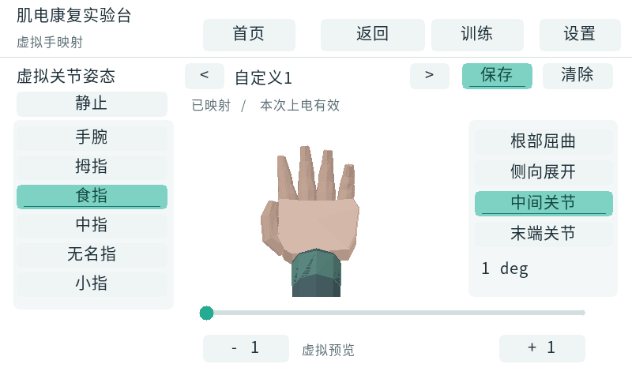

# 虚拟手自定义映射 — V13

版本：`20261026_HAND_CONTROL_HDC_DYNAMIC_V13`。

本版补齐 HDC 自定义类别到虚拟三维手的姿态映射，复用 V12 已验收 PL、XSA 和 FSBL，更新 PS 应用。NMF/HDC 计算继续在 PL；PS 完成映射编辑、识别来源选择和三维绘制。用户更新的作品名称与简介原文同步到工程 README。

## 使用

1. 在 **HDC 自学习**中完成采样和独立验证。进入 **设置 → 虚拟手映射**，也可由实时监测页直接进入。
2. 用顶部左右按钮选择已学习的自定义类别。左上姿态按钮循环选择基础预设作为起点；选择手腕或手指，再选择关节，用滑块和 `±1` 按钮调整，三维手实时预览。
3. 点 **保存**启用该类别的虚拟映射；**清除**取消映射。切换类别或离开后重进会丢弃未保存草稿。
4. 回到实时监测页，点击 **来源 MLP / 来源 HDC**切换。HDC 各类验证需达到原有 80% 门槛；非放松动作连续 3 窗、放松连续 6 窗确认，沿用机械手的稳定类别。
5. HDC 自定义类别显示保存的关节姿态，MPU 继续控制整体方向。未映射类别显示类别名和“虚拟姿态未映射”，虚拟手回到放松；无效、过期或模型未通过时显示等待状态。

机械手页面共享同一识别来源，但仍需独立标定、保存 PWM 映射并明确启用联动。编辑虚拟姿态、手动预览或切换识别来源均不自动启动 PWM；离开机械手页面仍执行原有停止策略。虚拟手 22 个关节角度与机械手 6 路脉宽独立保存，机械手腕屈/伸策略和 MPU 掌部旋转不变。

虚拟映射随 HDC 库在 DDR 中动态增长，无固定自定义槽位数；追加类别保留已有映射，全部重新学习时清空。模型与自定义映射仍为本次上电 RAM 数据，不宣称实现了 SD 模型恢复。HDC 显示“分离裕量”，不将其解释为概率置信度。基础五类、康复训练判断及 SD 人工动作标签仍沿用原有数据源。

## 验证与构建

- `lcd_test.log`：真实特征解析 → HDC 稳定类 → 虚拟姿态；保存、清除、预设、滑动、微调、未映射/过期保护、不隐式启动 PWM；800×480 与 1024×600，144 对页面路由、绘制一致性、帧缓存边界及原有功能回归。
- `hand_test.log`：六轴复位、持续保持、实时标定/映射、MPU、HDC 稳定保护及 RTL 回归。
- `hdc_golden_test.log`：动态库扩容时独立保留虚拟角度与机械手脉宽，分配失败原子性；C/NumPy 编码、原型、预测、裕量逐项一致。
- `learning_workflow_test.log`：正式 PL 后端工作流、完整试次、冻结验证、扩容和故障失效回归。
- `control_test.log`、`sd_test.log`：基础控制、数据记录回归。
- `build_boot.log`：ARM 编译、原 G1–G4 硬件验收及 BOOT 打包。
- `artifacts.json`：PL 位流、XSA、RTL 和 FSBL 对照 V12 哈希；BOOT 的 PL 分区、应用和 FSBL 加载段字节核验。

本版无 PL 逻辑修改，沿用 V12 资源和时序：LUT 36,417，FF 40,463，Slice 13,008，BRAM 45.5，DSP 111；WNS +0.229 ns、WHS +0.036 ns。界面与集成通过主机测试及 ARM 编译验证，实板触摸与实时运行需更新启动卡后验证。

## 启动镜像

`build/boot/BOOT_20261026_HAND_CONTROL_HDC_DYNAMIC_V13.BIN`，5,086,684 字节。
SHA256：`edeede249706ec21601d9464f0901d9376e54350dada31bc2400de289d07ef55`。

最终 LCD 回归 36 条 PASS；基础控制 8 条、机械手 6 条、SD 记录 3 条；HDC 整数金模型和正式 PL 工作流各 2 条。
G1–G4 均通过，复用硬件的 15 项文件哈希与 V12 一致；BOOT 校验 2 个应用加载段及 3 个 FSBL 加载段。
ARM 编译仅有已有通道检查和 FatFs 的未使用项告警，本轮新增代码无编译告警。未写入 SD 卡或实板下载。

