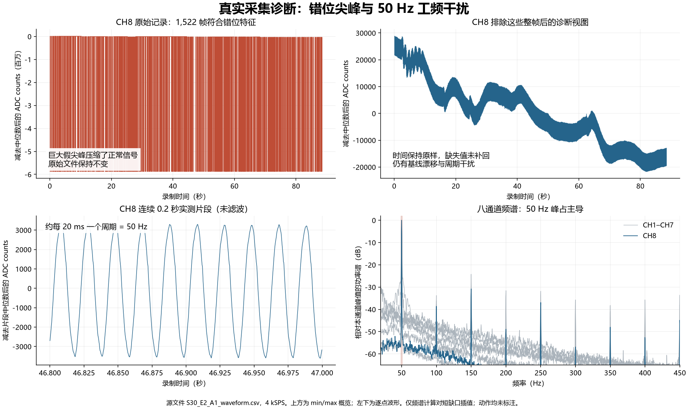
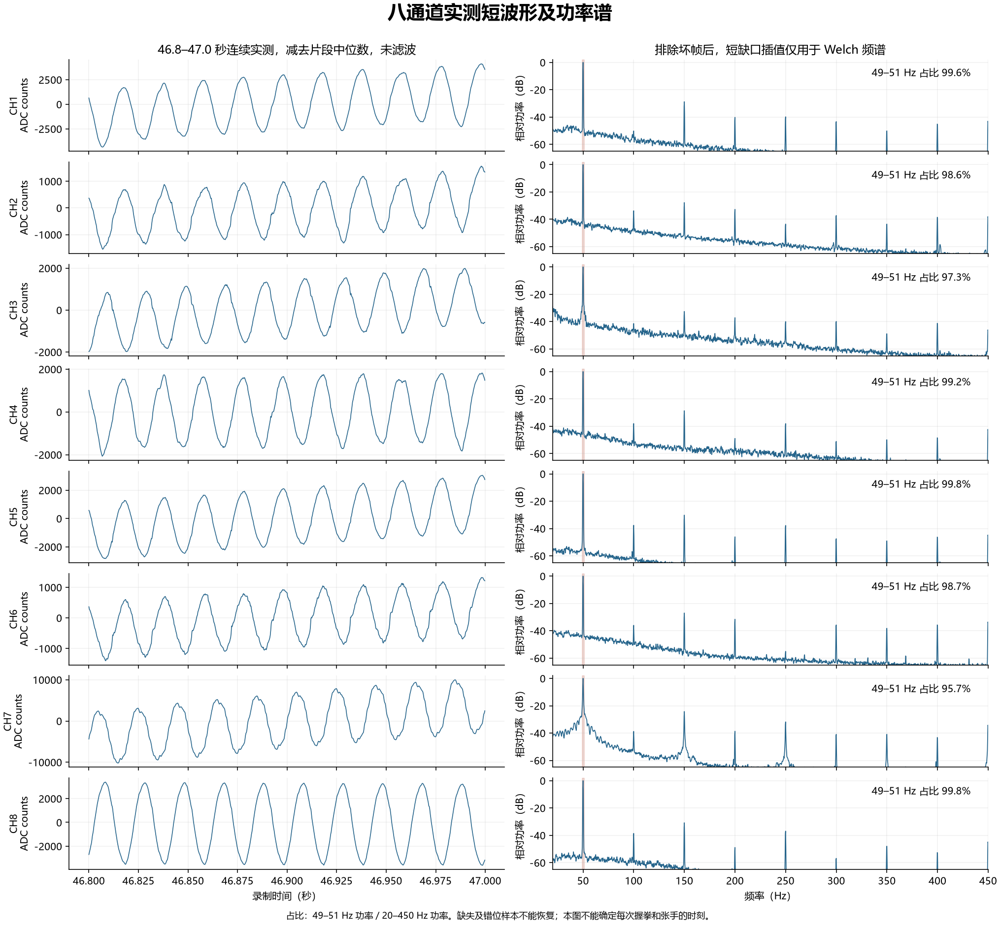
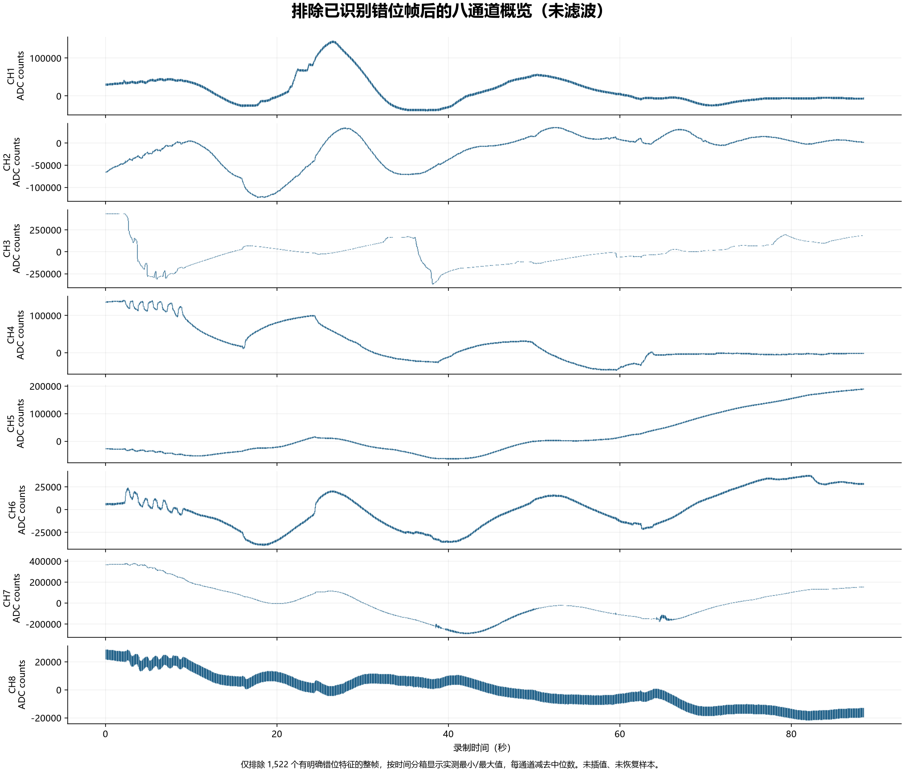

# 2026-10-15 八通道真实波形诊断

本次异常有两个明确来源：旧录制器接受了字节错位的坏帧，形成条形尖峰；排除这些帧后，八通道仍被 50 Hz 工频干扰和低频基线漂移主导。录制器已增加逐帧边界检查，但丢字节的物理位置及模拟干扰的具体来源仍待实机排查。

## 数据与实际操作

- 原始文件：[S30_E2_A1_waveform.csv](../../data/raw/board/s30/S30_E2_A1_waveform.csv) 及同名 JSON，均保持原样。
- 每通道 4,000 Hz，8 通道，2 Mbaud 串口，352,011 行，时间范围 0–88.445 秒。
- 用户确认：反复握拳、张手；各差分对贴紧皮肤；BIAS 电极接在手肘。
- 用户补充：电极导线约 0.6 米，为屏蔽双绞线，屏蔽层仅在 ADS1299 端接 AGND。电脑、开发板与直流稳压电源均接市电；稳压电源型号为 GPD-3303D，给采集模块输入 7 V。尚未确认输出负端与保护地的关系、两块板的具体供电关系、USB 接地及隔离路径。
- 已查阅用户提供的两页 ADS1299 模块原理图。用户明确说明部分实装取值与图纸不同，实际每路输入滤波截止频率约 800 Hz；不能用图纸的 100 nF 标注推断实物截止频率为 80 Hz。BIAS 实装已确认 R4＝1 MΩ、C25＝1.5 nF、R7＝0 Ω；手肘电极确实接 H1 第 18 脚 BIA，BIA 到电极之间没有其他串联电阻或保护电路。用户最新实测：+5V＝5.00 V、AVDD＝2.49 V、AVSS＝−2.50 V、DVDD＝3.32 V。直流数值符合标称目标，但纹波和整机隔离尚未验证。
- CSV 全部标为 `none`，没有各动作的具体起止时刻，不能据此给握拳或张手标注时间。
- 单位是有符号 24 位 ADC counts。未根据未经读回确认的增益和参考电压换算 µV。



## 1. CH8 的条形尖峰来自已保存的错位帧

共 1,522 行（约 0.432%）同时满足 CH8 高字节为 `AA`、紧接着出现时间戳缺口。所有 CH8 高字节为 `AA` 的行都落在这些位置，未见这种特征出现在连续时间戳中。这与载荷丢一个字节后，下一帧同步头的 `AA` 被误读为 CH8 最高字节一致。

第一处发生在 CSV 第 14 行（第 13 个数据样本）：

| 时间 | CH8 ADC counts | 24 位十六进制 |
| --- | ---: | --- |
| 2,750 µs | 261,619 | `03FDF3` |
| 3,000 µs | -5,635,074 | `AA03FE` |
| 3,500 µs | 262,273 | `040081` |

同一个坏帧还将 CH3、CH4、CH6 等通道改成巨大的异常值，因此诊断时排除的是整帧，不能只处理 CH8。全部 3,044 处相邻采样中至少一个通道跳变达到 100,000 counts 的位置，都紧邻这 1,522 个坏帧。排除这些帧后，不再有这样的突跳，也没有接近 24 位满量程的持续饱和。

旧录制器对序号连续的候选帧没有验证下一帧边界，使这种错位值被保存为有效采样。这是已经确认并修复的软件缺陷。现有 CSV 没有保留原始串口字节，无法重新对齐并恢复这些坏帧。

原 JSON 记录 1,770 个帧序号缺失、196 个伪同步候选。CSV 有 1,763 个时间戳缺口，间隔分别为 500 µs（1,756 处）和 750 µs（7 处），未见长时间戳停顿。序号缺失和已保存的坏帧是不同统计；不能把二者简单等同，也不能把缺口直接归因于 USB。

## 2. 排除坏帧后，50 Hz 干扰仍占主导

仅在派生诊断中排除上述整帧，保留 350,489 行的原始时间和数值。全程波形仍有明显基线漂移，放大 46.8–47.0 秒这个无缺口片段，可以直接看到接近 20 ms 的重复周期。

频谱诊断将排除坏帧后的数据按原时间对短缺口作线性插值，仅供 Welch 估计使用：采样率 4 kHz、Hann 窗、16,000 点、50% 重叠、线性去趋势。下面占比为 **49–51 Hz 功率 / 20–450 Hz 功率**，不是肌电信噪比，也不是动作识别准确率。

| 通道 | 49–51 Hz 功率占比 |
| --- | ---: |
| CH1 | 99.6% |
| CH2 | 98.6% |
| CH3 | 97.3% |
| CH4 | 99.2% |
| CH5 | 99.8% |
| CH6 | 98.7% |
| CH7 | 95.7% |
| CH8 | 99.8% |

为避免结论依赖插值，另外提取 45 个不重叠、完全连续的 800 点实测片段，共 9 秒。对这些片段直接计算并平均功率谱，八通道在 20–450 Hz 内的最大峰均为 50 Hz。此交叉检查分辨率为 5 Hz，片段来自有足够连续样本的位置，不能当作覆盖整次动作的均匀抽样。





正常肌电在握拳和张手时主要体现为一段宽带随机活动增强，而不是每次产生相同的规则曲线。目前的条形尖峰、工频和基线变化会遮住这种活动。现有数据不足以证明没采到任何肌电，也不足以确认某通道准确反映了某个手指。

## 3. 修复与验证

`tools/record_uart.py` 现在对每个候选帧要求下一个同步头位于准确的 28 字节边界。边界不符即拒绝并重新同步；序号用于保留时间缺口。末尾没有后续帧头确认的数据不保存，通常约一帧。状态栏和 JSON 增加边界拒绝计数，JSON 增加解析器版本及未确认尾部字节数。

协议本身没有 CRC，边界检查不能发现所有载荷位错误或碰巧仍对齐的损坏。此次修复拦截了回归测试中的同类错位，不代表已排除硬件丢字节。没有打开硬件串口验证新录制，也没有重新烧录。随后按用户要求新增了 PL 50 Hz 陷波，具体实现、测试和部署状态见 [陷波验证记录](../notch50_validation_20261015.md)；该变更需要配套新 PL/PS。

`sim/test_uart_waveform.py` 的 16 项测试通过，包含 24 个载荷位置分别丢一个字节、多种串口分块长度、插入字节、序号回绕、重复帧、伪同步、尾帧确认、完整保存、逐点绘图、原始/陷波来源标记及来源不匹配拒收。另有 9 项训练预处理测试通过。诊断脚本已成功运行，三张真实数据图均已目视核对。

## 4. 下一次录制与继续排查

先完成下述电源轨、BIAS 输出保护及人体供电、通信隔离核对，再用修复后的 PC 工具录一段短、有标注的对照数据。若上次按 `q` 保存后尚未重启、且板卡仍在采集模式：

```powershell
python tools/record_uart.py --port COM16 --signal raw --plot --keep-all --subject s30 --session e3
```

若板卡已重启回到监控模式，再增加 `--enter`。关闭其他占用串口的程序。单独的 PC 边界解析修复不需要烧录；此命令显式选 raw，兼容旧板端。新增 PL 陷波需要更新匹配的位流与 PS 固件，之后使用 `--signal notch50`。

前臂放稳，尽量保持导线不被动作拉动，在波形窗口中按键标注：

1. `1`：自然放松 5 秒。
2. `3`：握拳并保持 5 秒。
3. `1`：放松 5 秒。
4. `2`：主动张手并保持 5 秒。
5. `1`：放松 5 秒，然后按 `q` 保存。

保留 `--keep-all`，让过渡段也完整留下。观察 `drop` 与 `bad` 是否增长；二者的含义不同，边界检查也可能保守地拒绝部分正常帧。

模拟端需要结合实际 ADS1299 模块、供电和电极线确认。优先核对每个通道的两根线是否确实接到同一通道的 INxP/INxN、导线是否有过大环路及接触阻抗是否不平衡。BIAS 接在手肘这一事实已知，仅凭位置不能断言偏置反馈是否有效。

当前 `src/rtl/ads1299_spi.v` 默认写 `CONFIG1=0x92`、`CONFIG2=0xC0`、`CONFIG3=0xEC`、`CHnSET=0x40`，仅写到 CH8SET，没有显式写 BIAS_SENSP/N 及后续 SRB 寄存器。应结合模块原理图及实际寄存器读回，判断偏置电路是否按预期工作；源码不等于当前板卡已烧录配置。现阶段没有据此修改 ADC 寄存器或接线。

### 供电、屏蔽与 BIAS 反馈的进一步核对

本地 TI ADS1299 数据手册（ZHCS158C）第 9.6.1.4、9.6.1.7、9.6.1.8、10.1.3 节确认：`CONFIG3=0xEC` 开启内部参考与 BIAS 放大器；`BIAS_SENSP`（0x0D）及 `BIAS_SENSN`（0x0E）复位值均为 `0x00`。只有将相应位设为 1，才会把相应通道的输入纳入 BIAS 共模反馈。当前 RTL 每次先硬复位，再仅写 0x01–0x0C，因此在没有其他配置源的前提下，这两个选择寄存器保持全零。

这意味着当前源码开启了 BIAS 放大器，但没有选择采集通道用于主动共模反馈；若外部反馈电路按图实装，仍可提供直流偏置。**开启 BIAS 放大器、贴上 BIAS 电极、启用共模反馈是三个不同条件**。这是一项应优先核实的配置遗漏，尚不能单凭源码确认它就是本次 50 Hz 的唯一原因。数据手册还说明外部反馈电阻、电容和被选输入数量共同决定反馈增益与带宽；图纸与实物取值有差异，不能直接把两个寄存器全写为 `0xFF`。

0.6 米双绞线能减小线对拾取差分干扰，屏蔽层可减小电场耦合，但都不能消除身体拾取的共模干扰、接触阻抗不平衡及地回路的影响。用户已确认屏蔽层仅在 ADS1299 端接 AGND，这是常见接法，目前没有证据要求改成双端接地、接 BIAS 或接保护地。长度本身也不足以证明线缆有故障。

直流稳压输出不等于没有工频耦合，输出负端、保护地及电脑 USB 地之间的连接仍可能影响测量。电脑、开发板及 GPD-3303D 都接市电，并不能单独证明已经形成地环路，也不能证明采集系统已具备人体测量所需的隔离。排插本身不是已确认的故障源；电源型号与 7 V 设定值也不足以说明当前输出负端是否通过跳线或其他设备连接保护地。

### 原理图核对与实物差异

已完整目视核对两页原理图（第 1 页采集电路，第 2 页电源），并放大检查 BIAS、单路输入滤波及电源反馈连接。PDF 原件保持原样。

| 项目 | 图纸内容 | 当前判断 |
| --- | --- | --- |
| BIAS 外部反馈 | R4 为 1 MΩ，C25 为 1.5 nF，二者并联在 BIASOUT 与 BIASINV 之间；BIASIN 与 BIASOUT 相连 | 用户确认 R4、C25 实装取值与图示相同；R4 位于反馈支路，不是串联在人体电极路径中的限流电阻 |
| 人体偏置接口 | H1 第 18 脚为 BIA，经 R7（图示 10 kΩ）连接 BIASOUT；H1 第 1 脚为 SRB | 用户确认实装 R7＝0 Ω，手肘电极接 H1 第 18 脚，BIA 到电极之间没有其他串联电阻或保护电路；该路径没有专门的外置串联限流元件 |
| 每路输入滤波 | 两只串联 10 kΩ 电阻，输入两端跨接电容；图示 C24、C42–C48 为 100 nF | 用户确认实物截止频率约 800 Hz，以用户确认的实物信息为准，不能据图要求更换这些电容 |
| 模块输入 | VIN 经 TPS5430 降压，再产生模拟正负电源及数字电源 | 用户确认 VIN 为 7 V；板上实际电源轨不能仅由网名推断 |
| SPI 与地连接 | H2 为直接 SPI、控制和地接口，图中未画供电或数字隔离器 | 只能说明这两页图没有隔离环节；整机是否在其他位置隔离仍待确认 |

最新实物确认意味着 BIASOUT 经 0 Ω 的 R7、BIA 接口和导线直接连接手肘电极。R4 的 1 MΩ 与 C25 构成放大器反馈，不能把这只电阻当作人体连接路径的串联保护。已要求先将全部人体电极取下，后续电源测量不连接人体。**R7＝0 Ω 是输出保护需要处理的独立问题，尚不能据此认定它造成了本次 50 Hz 干扰；恢复任意一只电阻也不等于整套系统已满足人体测量条件。** 在输出保护和整机隔离条件核实前，不启用新的主动 BIAS 反馈配置进行人体测试。

按上述一阶差分 RC 拓扑，`fc = 1 / [2π × (RP + RN) × C]`。图示数值会得到约 79.6 Hz，但这只说明图纸与实装取值不同。若实物为用户确认的约 800 Hz，一阶模型在 50 Hz 的幅度衰减仅约 0.017 dB，在 450 Hz 约 1.19 dB；因此它不会滤掉当前强烈的 50 Hz，也不能被认定为此次肌电宽带活动受严重压制的原因。

电源页另有需要实测核对的图纸矛盾：TPS5430 的 R5、R6 标为 11 kΩ、1 kΩ，按 TI 数据手册 `Vout = 1.221 × (1 + R5/R6)` 对应的反馈目标约为 14.65 V，而网名是 +5V。**这是反馈设定的计算值，不是实测输出；TPS5430 是降压器，7 V 输入不能据此推出实际输出 14.65 V。** TLV70025 的 EN 在图上接 GND，而其数据手册规定 EN 低电平关闭输出；U7 的型号标注与 DVDD_3V3 网名也需要核对。用户已确认图纸与实物有差异，这些均不能直接认定为实物故障，更不能按图盲目改线或升高输入电压。

用户现已提供实测 +5V＝5.00 V、AVDD＝2.49 V、AVSS＝−2.50 V、DVDD＝3.32 V。模拟供电跨度为 4.99 V，直流目标基本正常，图纸中电源标注矛盾不能据此认定为实物故障。万用表直流值不能排除 50 Hz/开关纹波，也不能证明整机隔离。BIAS 实装参数及电极接口已确认，仍需处理偏置输出保护、核实整机供电和通信隔离，并读回实机寄存器，之后再确定 BIAS 选择掩码；本次未改变 ADC 寄存器或启用新的 BIAS 通道反馈。数字陷波仿真已完成，尚未烧录验证。

在电源与隔离核对完成后的对照中，一次改变一个条件：可先让电极线远离排插与电源线，固定导线走向，再对比相同标注静息段的 50 Hz 分量。进一步供电对照需要先确认板卡电压、电流及隔离条件。仅把 ADS1299 换成电池、同时保留有市电地连接的开发板或 USB，并不能证明整个采集系统已隔离。

人体电极测量需要合适的供电和通信隔离。确认隔离条件前，不建议继续用未知隔离状态的市电连接方案做人体对照实验；不要通过拆除保护地、把人体/BIAS 接保护地或带电改线来排除噪声。

先验证传输与信号质量，再决定滤波和训练。离线陷波能减弱 50 Hz，不能修复错位样本、恢复丢失数据或证明采集已经合格。这份录制可作诊断依据，暂不当作干净的训练基线。

## 可复现性

- [统计与坏帧行号](statistics.json) 包含排除规则、每个坏帧在原 CSV 的行号及频谱计算方法。
- `analyze_capture.py` 可重做本目录三张图及统计，复用现有 CSV 读取与缺口识别函数；需要 NumPy、Pandas、SciPy、Matplotlib。
- 原始 CSV SHA-256：`4aa4ae034a50ee20277f1e27dc7854eb74f903c1a1360a801277a430ca29b5f5`，分析前后核对一致。
- 报告中的排除规则仅用于这份已有录制，未加入普通查看器自动删除采样。图中的剩余样本也不能视为经过 CRC 验证的数据。
- 用户提供的原理图原件：`D:\电脑管家迁移文件\xwechat_files\wxid_ait3nzfjnd1g22_ae1e\msg\file\2026-10\SCH_Schematic1_2026-10-15.pdf`，2 页；SHA-256：`e5ad91930b991a7bf65a1b765b067a3202e5538c7a05a1cd3c267623a094684a`。已区分图示标注与用户确认的实物参数。
- 电源图纸核对依据：[TI TPS5430 数据手册](https://www.ti.com/lit/ds/symlink/tps5430.pdf) §7.2.1.2.5（第 16 页）和 [TI TLV700 数据手册](https://www.ti.com/lit/ds/symlink/tlv700.pdf) §5（第 4 页）。不据此推断实物已安装的具体阻值或接法。
