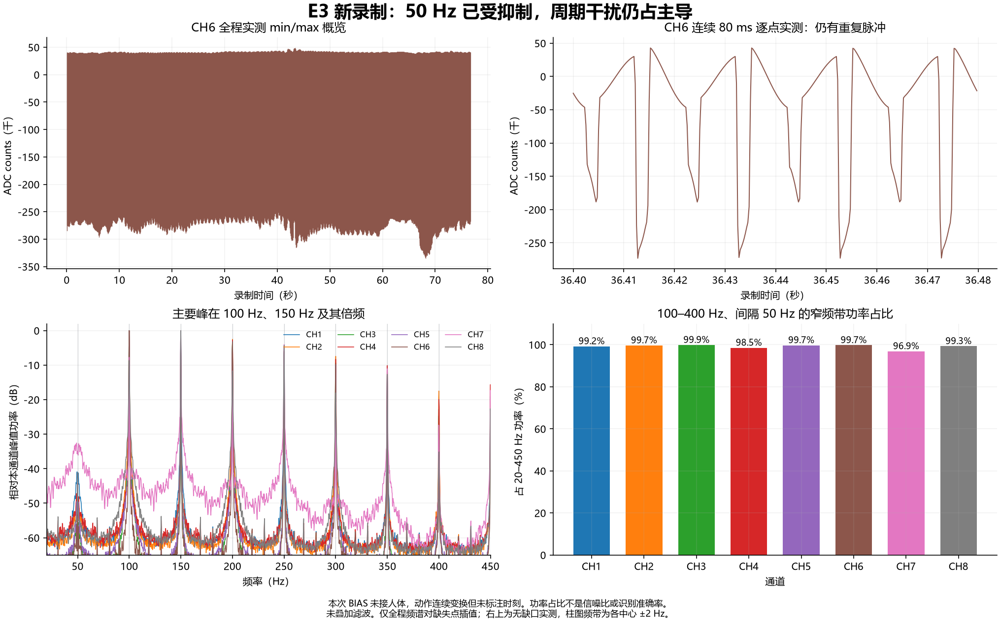
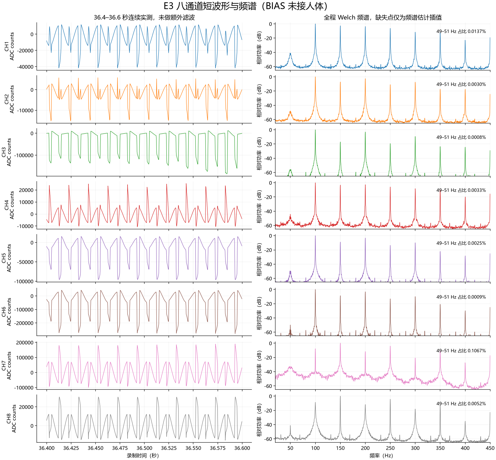

# E3 录制与 BIAS 接触后门控的诊断

后续软件更新：已增加 CH1 P/N 对称 BIAS 配置和 SPI 实际读回，详见
[BIAS 验证记录](../bias_bench_20261015.md)。以下保留此前录制与诊断时的历史状态。

## 最新硬件状态：2026-10-15 后续确认

用户已确认拆除 R3；随后将 BIA 串联位置 R7 从 0 Ω 改为 100 kΩ，电脑与串口之间
加入正点原子 USB2.0 隔离保护模块。用户报告小信号注入后波形显示正常。
以下历史段落中的 R3/R7 装配状态按各次询问时记录保留，当前以本节为准。

小信号结果是用户观察，尚未提供本次注入通道、频率、幅度和对应原始采样，
可以作为已测通道输入/采样/显示链路的初步验证，尚不能推广至八通道精度、串扰或
BIAS 共模闭环抑制。100 kΩ 提供外部串联限流；以该电阻两端 2.5 V 为例，电流为
25 µA，这只是欧姆定律下该支路的计算值，不是整机实测漏电或人体连接合格结论。
改变串联阻抗后，BIAS 输出负载和环路响应仍需实际验证。

用户进一步确认型号为 ATK-POHUB23，仍使用 GPD-3303D 供电，除经隔离器的
串口 USB 外，没有 JTAG、其他 USB、信号发生器或示波器连接。用户补充产品介绍
列出含强电/强干扰环境及医疗设备应用。

已从正点原子官方网站的资料下载入口核对到
[USB2.0 高速隔离器 HUB23 官方资料页](http://www.openedv.com/docs/industry/6-other/HUB23.html)，
因此按真正的 USB 隔离产品对待；不能继续按普通过流保护板或“型号未知”描述。
资料页链接到官方论坛及网盘，当前尚未取得可核查的完整说明书/原理图中的
具体数据、供电、外壳隔离结构以及隔离额定值、漏电指标，不自行猜测芯片型号。
USB 路径的隔离措施与整机人体连接条件分别评估，剩余供电路径仍涉及 GPD-3303D。
厂商列出医疗设备应用不能单独给出这套自制采集系统的实测漏电或合格结论。

再次核对当前 RTL：CONFIG3=0xEC，仍仅初始化 0x01–0x0C，尚未显式写入
BIAS_SENSP/N，也没有新增寄存器读回；本次没有修改 ADC 配置或更新位流。
后续可先在无人体等效负载下以一对 P/N 对称选通验证 BIAS，检查直流偏置、输出
饱和/振荡和共模抑制，再根据实际接线及保护/隔离条件确定人体测量安排。

## 后续确认：R3 实装与使用方式

用户随后确认 R3 焊了 0 Ω；计划日常整套电池供电、仅用 LCD，PC 仅用于数据采集和训练。再次目视复核原理图：R3 连接 BIASOUT/BIA 节点与地，且图中明确注明保持开路、不要焊接。若实物连接与图一致，0 Ω 的 R3 将该输出节点短接到地，是需要优先排除的已知装配问题。处理方法是断电、移除全部人体电极后拆除 R3，保持其位置开路，保留 R4/C25 反馈支路；检查焊盘锡桥并在无人体条件下验证。未确认用户已经完成此修改。

R3 接地会妨碍 BIAS 正常驱动，但不能仅凭此证明全部门控及周期干扰均由 R3 引起。当前模拟电源约为 ±2.5 V，正常偏置中点也接近本板 AGND，故 BIA 对地测得约 0 V 不能单独区分正常偏置与被 R3 短接。

R3 与 R7 的作用不同：拆除 R3 不会补上 R7=0 Ω 路径缺失的串联输出保护。整套电池供电、停止充电并断开外部 USB/JTAG/网线等连接，可避免这些外部有线连接引入的路径，但不替代全部电极路径保护及故障电流核对。连接 PC 做人体数据采集时仍需合适的供电/通信隔离；仅对已保存数据离线训练不需要人体连接。当前 2 Mbaud 波形链路要求隔离接口支持相应速率。本次未改变硬件或固件。

用户确认：这次录制时 BIAS 全程没有接触人体，持续交替放松、握拳、张手，未记录动作时刻。BIAS 接触后出现“门控”的现象发生在监测模式、未录制时。最近一次静息校准时 BIAS 是否接触人体不确定。

## 结论

BIAS 接触后显示门控，并不意味着采集停止或 BIAS 关闭了肌电。当前软件没有 BIAS 接触检测：它根据带通后的八通道活动幅值和静息校准阈值，覆盖神经网络的非放松判定。

一个需要验证的解释是：静息校准时干扰较大，抬高了活动阈值；BIAS 接触后输入偏置或共模状态改变，采集幅值降低，八通道都低于旧阈值。由于校准状态不明、且本次没有 BIAS 接触后的数据和阈值日志，不能确认这就是根因。输入接线、接触或共模工作范围异常，也可能使有效活动变弱。

用户已确认现象发生在监测模式，因此不能用“录制模式保留旧门控提示”解释。本次文件是在 BIAS 未接人体时录制的，不能用于判断接触后的肌电质量。

## 新录制的已确认结果

- 来源：S30_E3_A1_waveform.csv，同名 JSON 标注 PL notch50、AA56、notch50_q10_q24_v1、解析器版本 3。
- 4 kSPS，八通道，305,158 帧，76.70475 秒。
- 缺失 1,661 个帧序号，占 0.541%。共 1,607 个时间缺口：1,553 个 500 微秒、54 个 750 微秒。这是端到端统计，不能直接归因于 UART。
- 边界不符候选被拒绝 1,612 次。旧 CH8 高字节 AA 错位特征本次为零，八通道没有达到 int24 满量程。协议没有 CRC，边界验证不能保证所有载荷均无误。
- 50 Hz 分量很小，但 100 Hz、150 Hz 及其他间隔 50 Hz 的窄带峰仍占主导。不能把当前数据当作合格的肌电训练基线，也不能由此计算动作识别准确率。

| 通道 | 49–51 Hz 功率占比 | 100–400 Hz、间隔 50 Hz、各 ±2 Hz 合计占比 | 连续实测片段的主峰 |
| --- | ---: | ---: | ---: |
| CH1 | 0.0137% | 99.24% | 100 Hz |
| CH2 | 0.0030% | 99.66% | 100 Hz |
| CH3 | 0.0008% | 99.86% | 100 Hz |
| CH4 | 0.0033% | 98.55% | 100 Hz |
| CH5 | 0.0025% | 99.73% | 100 Hz |
| CH6 | 0.0009% | 99.75% | 100 Hz |
| CH7 | 0.1067% | 96.87% | 150 Hz |
| CH8 | 0.0052% | 99.29% | 150 Hz |

占比的分母均为 20–450 Hz 功率，不能称为肌电信噪比。全程频谱使用 16,000 点 Hann Welch、50% 重叠、线性去趋势，仅频谱估计对短缺口插值。独立检查使用 21 个无缺口、互不重叠的 800 点实测片段，共 4.2 秒，没有插值，主峰与表中一致。按其 5 Hz 分辨率将谐波积分频带扩为各 ±5 Hz，合计占比 96.21%–99.87%。连续片段覆盖不均匀，不作为动作统计。

谱线符合工频谐波类干扰，但单凭频谱不能确定来自电源、接线还是采集链路。没有再对数据叠加滤波。上次 E2 为 BIAS 接触人体时的原始 ADC，本次 E3 为 BIAS 未接人体时的陷波输出，不能据此计算同条件实测抑制度。

## 对照代码

- sw/ps_uart_print/main.c 的 cal_on_window：启动后丢弃 80 个特征窗口，再平均 16 个窗口的 MAV，阈值为 max(静息基准 ×3, 1000)。完成后阈值保持，直到重新校准。
- rest_gate：只有八通道当前 MAV 全部低于各自阈值才成立。MAV 是带通后 400 点绝对值之和，不能拿录制 CSV 的单点幅值直接比较。
- print_result_row：校准完成、网络原判为非放松、rest_gate 成立时覆盖为放松，并令 gated=1，LCD 显示门控。
- 录制模式调用 record_buffer，只导出选中的波形，不更新 PS 的肌电手势/门控判决；MPU 和触摸仍轮询。此行为不解释用户已经确认的监测模式现象。
- src/rtl/ads1299_spi.v 当前硬复位后写 0x01–0x0C；CONFIG3=0xEC 开启 BIAS 放大器，没有写 BIAS_SENSP/N。没有其他配置源时，通道共模反馈选择保持复位值零。源码不能代替实机寄存器读回。

## 后续核对顺序

先核对硬件连接条件，再在最终固定接线状态下进行静息校准，比较 [CAL] baseline/thr 和放松、握拳、张手时的 [STAT] MAV。若实际用力仍低于阈值，需结合接触后波形判断阈值不匹配还是有效信号过弱；若 MAV 超过阈值，则继续查网络分类、置信度和输出时序。当前不能仅为消除提示而放宽阈值或继续堆叠谐波陷波。

已确认 BIA 到人体经 R7=0 欧姆且没有其他串联保护，整机供电/通信隔离未核实。应先断开全部人体电极，处理偏置输出保护并核对整机隔离。R4=1 MΩ 位于反馈回路，不是人体路径的串联保护。不要去掉保护地或把人体/BIAS 接保护地。

在人体连接条件确认后，使用监测模式，在 BIAS 和其他电极接法固定、前臂放松的状态重新校准。默认诊断关闭时，小写 d 开启调试输出，小写 c 启动约 2.4 秒的肌电静息校准；这与 MPU 姿态归零无关。若仍在 2 Mbaud 录制模式，应通过现有界面返回监测，不要在错误波特率下发送命令。本次没有进行新的硬件连接、校准、烧录或采集。

## 可复现性

分析脚本复用 tools/plot_csv.py 的读取、缺口识别和分箱函数。本机已有 NumPy、Pandas、SciPy、Matplotlib；捆绑运行时缺少 SciPy/Matplotlib，分析使用已有本机科学计算环境。

原 CSV/JSON 在分析前后 SHA-256 一致。CSV：0f94a90cc682be85bfef052c84627676f783f299b5c799470eb53926e0516f25。JSON：0eebc34f9e9bcb8dc235d55427154cc781f4bc55e8b1cc083469463badf837a8。详细数值与方法保存在 statistics.json。

本次只增加诊断派生文件，没有修改原始记录、模型、阈值或 PL/PS 代码。
